# FaderFrame

A multitrack recording, editing, mixing and mastering environment written in
Rust — Linux first, Wayland native, GTK 4 native; Windows and macOS builds
come from the same code.

FaderFrame aims to be a professional DAW: graph-based routing with buses,
aux sends, folder buses and sidechains, hard-realtime multicore audio
processing with automatic plugin delay compensation, MIDI and virtual
instruments with a key, a chord track and MIDI effects, modulators and
parallel effect containers, automation, CLAP/VST3 hosting (LV2 on Linux,
Audio Units on macOS), an analogue-console-style mixer with modelled
preamps, console summing and cue mixes for the performers' headphones, a
full set of stock devices, mastering meters, surround, object-based (ADM
BWF) and IAMF masters with binaural monitoring, album delivery down to CD
and vinyl masters, video for working to picture, lead sheets, scratch
pads, project templates, and dockable, detachable editors.

> **Status: in active development** (version 0.23.0). Most of a working
> DAW is there; see
> [docs/ARCHITECTURE.md](docs/ARCHITECTURE.md#status-and-roadmap) for what
> comes next.

## What's new in 0.23

* **Arranger**: a clip clipboard (copy, cut and paste across tracks; Shuffle
  inserts), Select All (Ctrl+A), splits that keep every piece selected, slip
  editing (Ctrl+Alt+drag), Snap to Objects with a guide line, a grid drawn
  at every zoom (its strength in Preferences → Editing), folder buses and
  folder groups, scratch pads, a Play Start Marker, and an audit of the
  arranger and recording that fixed 33 defects.
* **Transport**: the loop dragged or resized while playing without a
  glitch; Return to Start on Stop beside Return to Project Start on Stop
  (also on the Stop button's right-click menu); abort the take (Ctrl+Space)
  or abort it and record again (Ctrl+Shift+Space); a count-in before bar 1
  when the pre-roll cannot reach back (the counter shows bar 0 and
  COUNT-IN); show mode arms each song's stop ahead.
* **Mixing**: a send or cue send with a pan of its own places its source;
  cue mixes are complete (buses and returns solo- and mute-safe,
  automation, MIDI learn, control surfaces, talkback); the Inspector (F11)
  and the Channel Overview; check marks on every menu toggle.
* **Rendering**: a report measured from the written files after every
  render and album export; every export asks before replacing a file and
  swaps the new one in only once it is complete.
* **Audio**: a new Audio preferences page (devices, a second device through
  PipeWire or JACK, rate, buffer, channels, where each channel goes,
  latency); buffer changes applied live where the audio system can;
  recovery when a device goes and comes back; recordings placed by the
  device's real latency.
* **Plugins and devices**: favorites in categories (plugin browser and
  insert menus); sandboxed editors no longer close right after opening
  (#12); the Synth's second wave in a three-deck editor with 33 more
  presets — 470 factory presets across the built-in devices.
* **Stability**: the 0.22 crashes fixed — realtime threads past rtkit's
  time limit are demoted instead of the process being killed, and memory
  prefaulting, GPU errors and GStreamer's MXF demuxer no longer bring it
  down — and a crash reporter: a crash leaves a report in the Crash
  Reports folder, and the next start offers it.
* **Look**: Lumen, a ninth skin drawn with light instead of hardware.

## Screenshots

They show the demo session (`--demo`, or Preferences → General → On
start-up): eight bars in A minor whose audio is generated, so it needs no
files (the vocals, picture and drum-sampler shots add imported files). The
main set is in the default Studio skin.

### Arranging, editing and recording

The Editing workspace: markers, the Intro and Verse sections, the key and
the chord track above the tracks, the arpeggios in a folder, and in the
bottom dock the pad's modulators — an envelope follower that ducks it under
the drums and a synced LFO that moves it across the stereo field. Beside
the transport are the Q (input quantize) and the "i" (Inspector) buttons:

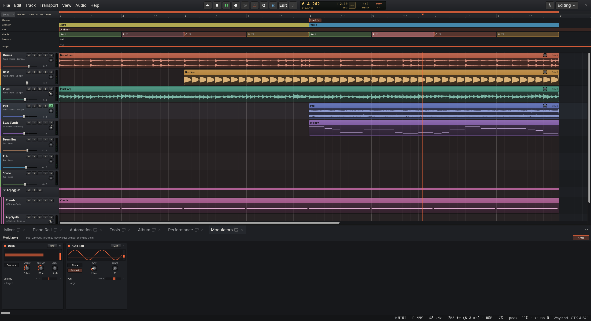

Snap to Objects: the Bassline dragged in Slip mode (where nothing else
attracts it) lands on the start of the Pad and Melody clips at bar 5; the
guide line names what it caught. Above it the edit toolbar, with Objects
and Samples (snap to samples) on:

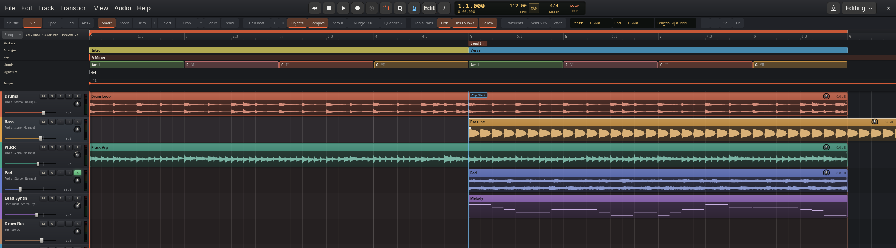

A scratch pad: the Verse copied into a pad of its own ("Verse Idea" —
its clips, section, key and chords) to try something without touching the
song. The switcher in the arranger's corner shows the pad in the accent
colour, the ruler is tinted, and its menu goes back to the song, makes
new pads or brings this one into the song:

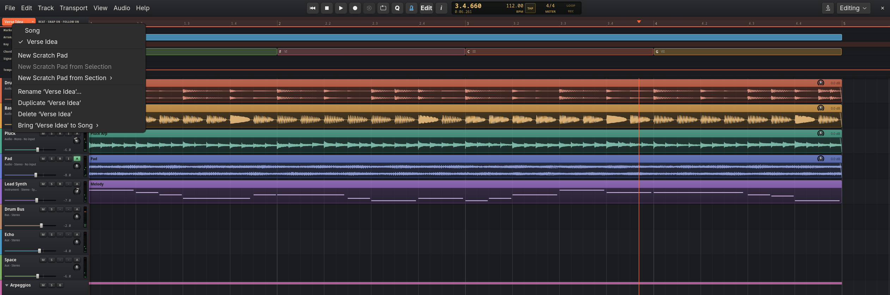

Recording from bar 1 with a two-bar pre-roll: what lies before the
project's start is counted in — the counter runs up from −1.1 with
COUNT-IN under it and the ruler shows a badge — and playback and the take
begin on bar 1. The Transport menu holds the stop behaviours, aborting a
take, the Play Start Marker and check marks for every switch:

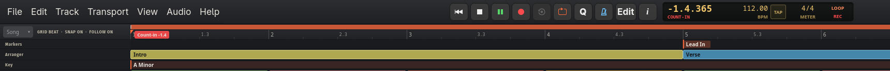

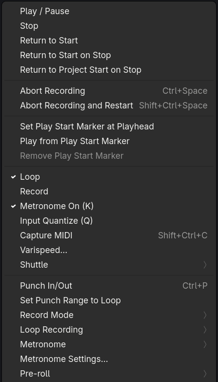

The MIDI workspace with the piano roll editing the lead synth's melody,
the key and the chords above the notes and the scale highlighted:

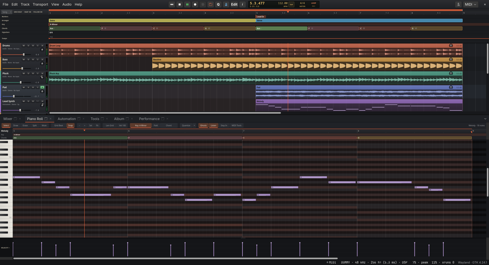

Clips: the plucks' harmony and the drum loop's hits converted to MIDI on
new tracks under them, and the pad's clip effects (a compressor, a
saturator and a reverb rendered into the audio it plays):

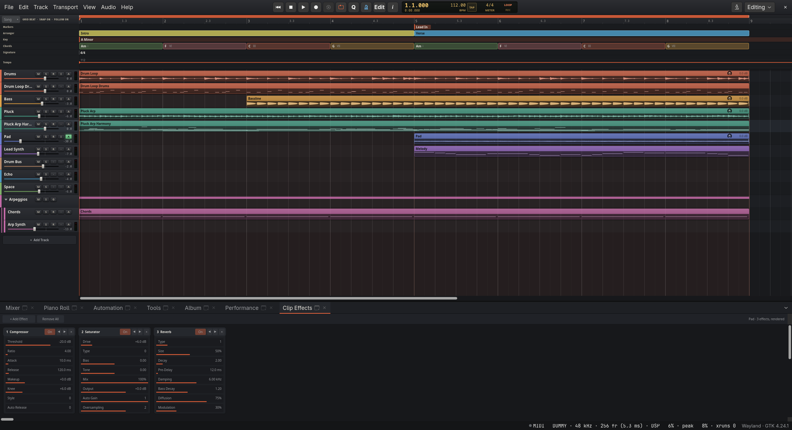

Vocals: a sung phrase in the pitch editor, its notes corrected to the key
(their sung positions faintly behind them, the vibrato halved), and a
speech clip transcribed into the Lyrics lane above the tracks (both
imported into the demo):

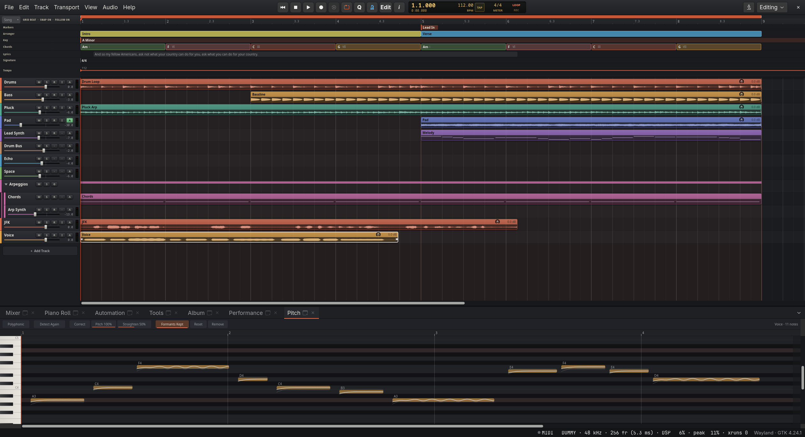

### Mixing

The Mixing workspace: a preamp on the bass, inserts, sends to an echo and
a reverb aux, a MIDI track's strip (it plays the arpeggiating synth), the
drum bus's parallel-compression container and a true-peak limiter on the
master:

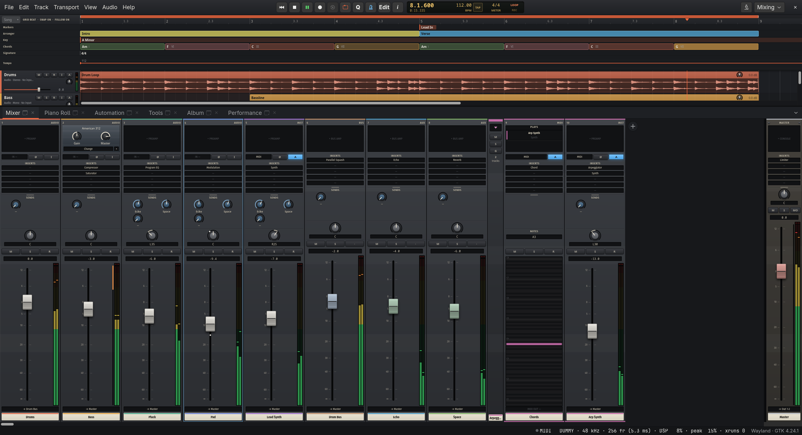

The Inspector (F11, or the "i" in the header bar) on the left with the
selected bass track — its routing, track settings, devices (with their
latency and gain reduction) and its channel strip — and the Channel
Overview in the bottom dock: input → American 312 preamp → Compressor →
Saturator → channel → sends → output:

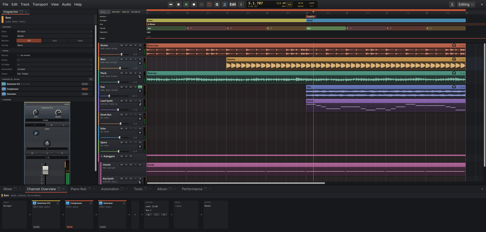

Folders that are buses and groups: the Arpeggios folder sums its tracks
(BUS in its header, its strip a FOLDER BUS in the Inspector) and its G
switch makes them one for editing and arming:

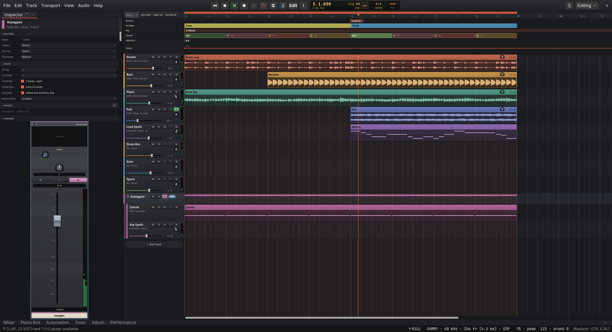

A cue mix for the performers' headphones: the bar over the strips switches
the mixer between the main mix and Cue 1 (Copy Main Mix, pre-fader taps,
TALK latched); every fader, pan and mute now sets the track's send to the
cue mix, framed in its colour — a track that reaches the master through a
bus is off by the console rule (the drums go through the drum bus) — and
the master section is the cue mix's own, on outputs 3–4 with its click:

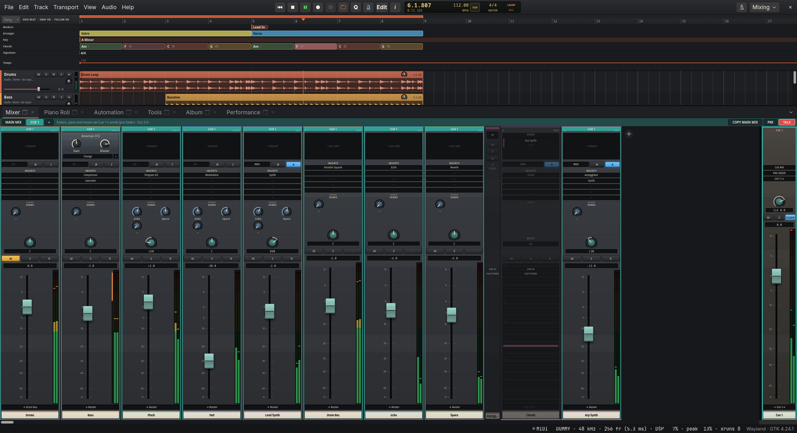

A multi-output instrument: the Drum Sampler on the lead synth's track
plays its pads (loaded with six samples, its editor on the right) into
its outputs, and Create Output Tracks gave every output a track of its
own in one step — Lead Synth Main and Out 1–8, in a folder under the
instrument, routed where it went (its own track now only carries the
instrument):

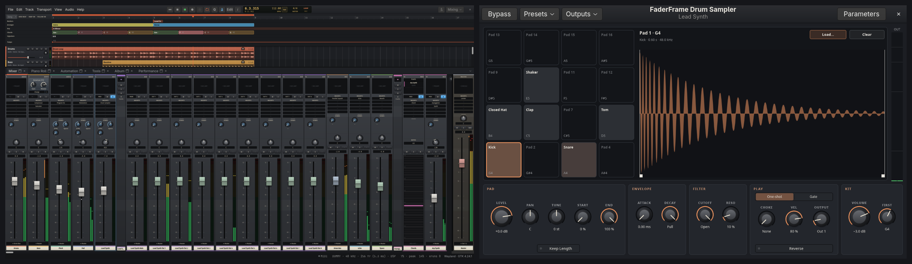

Surround and objects: the master as a 7.1.4 bed, the tracks placed in its
room (the small rooms in the mixer strips, their meters showing every
channel), the lead synth as an object, and the Surround Panner with the
pad behind the listener and up high:

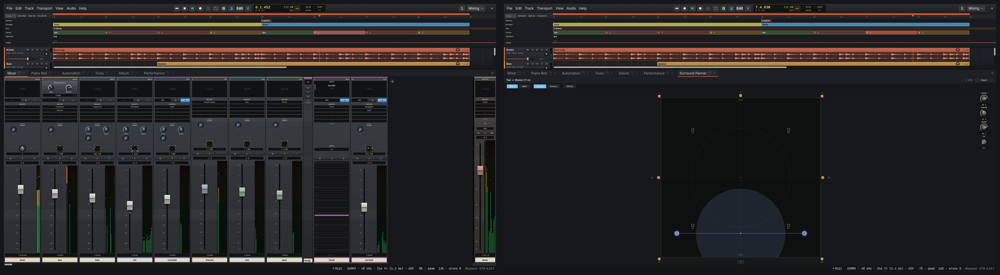

### Devices

Device editors: the EQ (dynamic and spectral bands, analyser), the Synth
(three decks of sections under its oscillator, filter and envelope
displays — LFO 2, the mod envelope, the modulation matrix, the wheels,
chorus, delay and reverb among them), the Program EQ and the Parallel
Squash container on the drum bus:

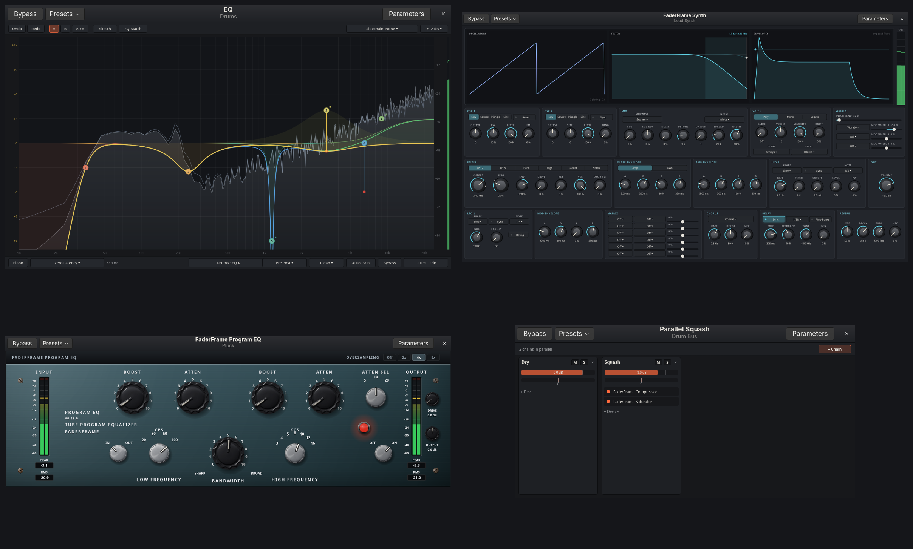

The Compressor on the bass (its transfer curve and the gain reduction over
the signal), the true-peak Limiter on the master with its loudness
readouts, the Reverb and the Delay (Echo):

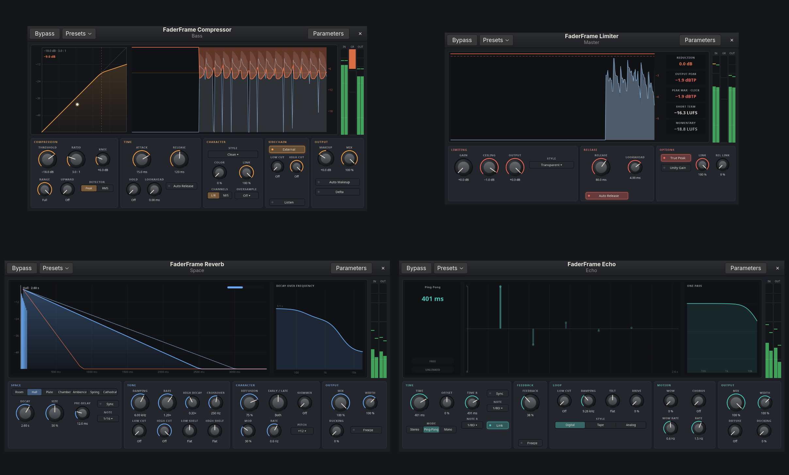

### Mastering and delivery

The Mastering workspace with the Tools view (EBU R128 loudness, levels,
phase and spectrum):

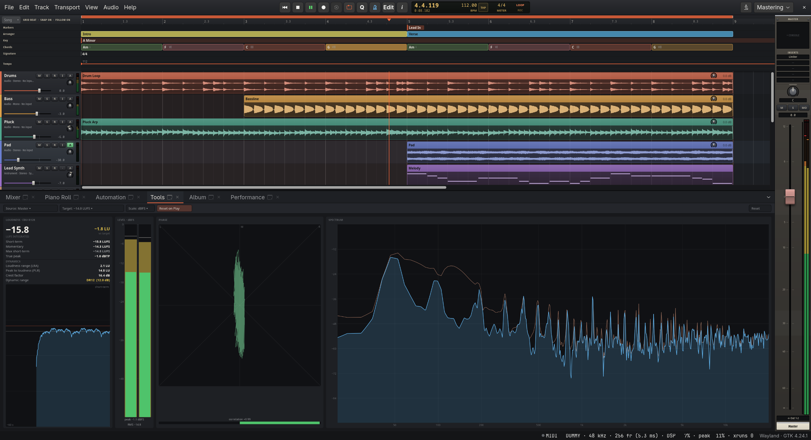

The album: the demo's sections as songs, analysed, with what delivery will
make of them (levelling, limiting) and the CD and vinyl masters a click
away:

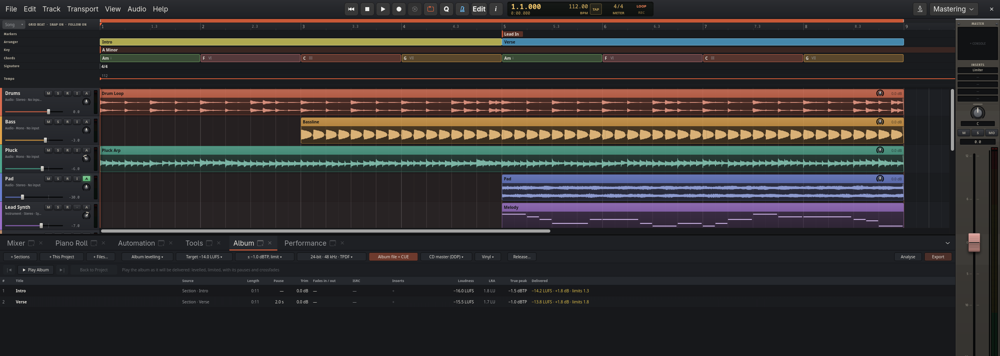

After every render and album export, a report measured from the files as
written:

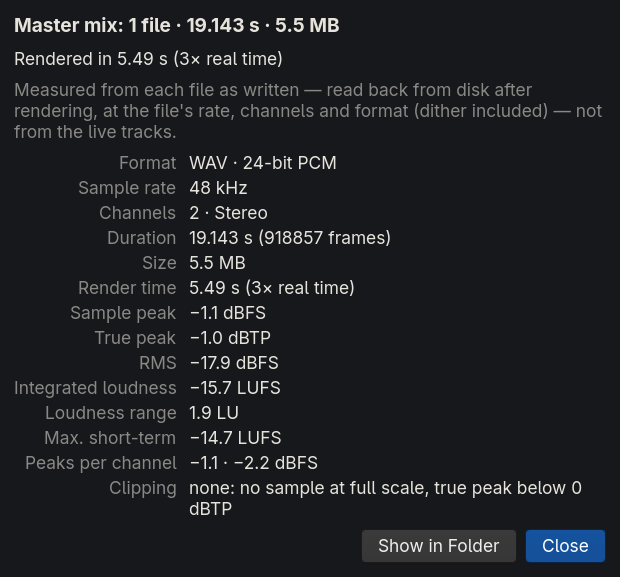

### Picture and performance

Picture: a movie in the arranger's Video lane above the demo (a filmstrip
of the clip) and the video window in the bottom dock, frame-exact against
the sound — the time burnt into the picture (10.440 s) and the overlay's
project timecode (00:00:10:11 at 25 frames a second) agree:

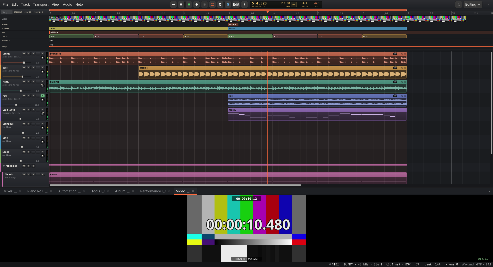

The clip launcher: the demo's clips sent to it in four scenes, the Verse
playing (green, each clip's loop progress under its name) and the Chorus
waiting for the next bar (yellow). The letters are launch modes (G gate,
T toggle, R repeat, L legato), the chevrons follow actions. Record to
Arrangement is on: every loop played to its end is already written into
the arrangement above, where the tracks that play the launcher are
dimmed:

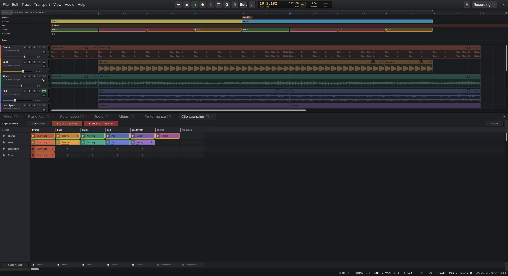

### Setting up

Preferences → Audio (here on the silent dummy device with a pretend
eight-channel interface): the devices, sample rate, buffer size and
channels, then what runs — the stream, the latencies (recordings move back
by the input and output latency) and where each channel goes. With
PipeWire or JACK it also offers a second device to play on or record from:

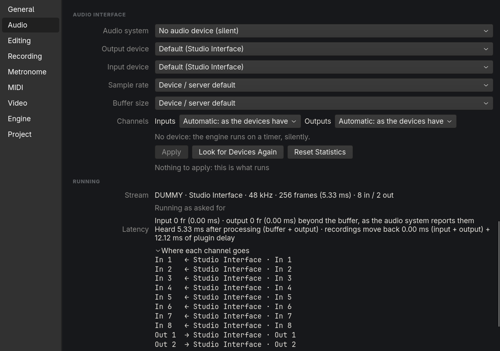

The plugin browser with favorites in categories of your own, a plugin's
details and its realtime check:

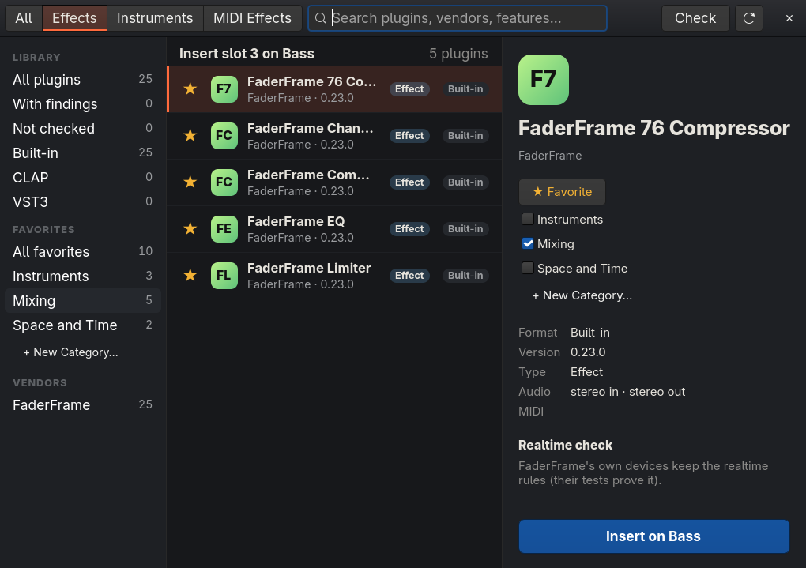

### Skins

Nine skins, switched live (View → Theme or Preferences → General → Theme):
Studio, Vintage Console (walnut cheeks, enamel panels, skirted knobs,
plasma bar-graph meters), Daylight (light), Midnight, Frost, Fjord (dark
slate and petrol panels with coral and old-gold light, calm contrast for
long sessions), Neon, High Contrast and Lumen:

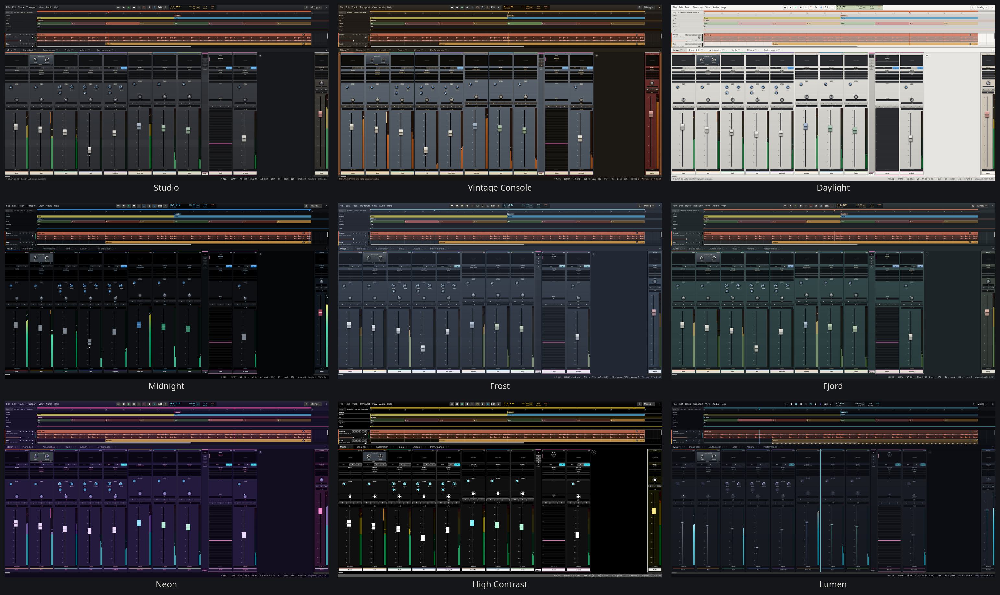

Lumen, the newest, is drawn with light instead of hardware: ink planes
stepped by luminance, halo knobs with glowing value arcs, pill faders and
buttons that light from within, fine gradient meters with a bloom, clips
as translucent cards, a glass transport display in tabular figures and one
cyan-to-violet accent:

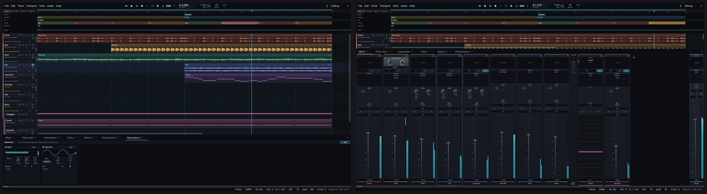

## What works today

* GTK 4 application, native on Wayland, HiDPI/fractional scaling via GTK.
  Optionally the analysers, the EQ and the devices' faces are drawn on the
  GPU (vello on wgpu; Preferences → General → Drawing): the mastering tools
  went from 26 to 55 frames a second, and the frames go to GTK without a
  copy through the CPU — as dmabufs on Linux (60 frames a second), as
  shared D3D12 textures on Windows.
* Arranger (virtualised): tracks, audio clips with waveforms, MIDI clips,
  move/split/delete, snapping, zoom down to single samples with the grid
  drawn at every zoom where clips snap (how strongly: Preferences → Editing
  → Grid lines), loop range (dragged or resized while playing without a
  glitch), playhead, console-style track headers with mute/solo/arm/monitor,
  volume, pan and meters (the wheel over the headers turns their faders and
  knobs and never scrolls; a held scrollbar stops the view following the
  playhead). Clicking a clip selects it and moves the playhead to the
  (snapped) click; Shift-click selects from the last clicked clip,
  Ctrl-click toggles one, Ctrl-drag draws a rectangle, Ctrl+A selects every
  clip shown, and moves, trims, fades and gain changes apply to every
  selected clip. Splitting (S, or B with a range) keeps every piece
  selected, so aligned drums split again without reselecting.
* Snap to Objects (on by default; Edit menu, the edit toolbar's Objects,
  Preferences → Editing): a drag within 8 pixels of a clip edge on any
  shown track, a marker, a section, the loop, the edit selection, the Play
  Start Marker or the stopped playhead lands on it, before the grid, with a
  guide line naming what it caught; automation points, tempo points,
  chords and piano-roll notes snap the same way. Alt bypasses all
  snapping; in Slip mode only objects attract.
* Clipboard: Ctrl+C/X/V/D copy, cut, paste and duplicate the edit range
  (with its automation) or else the selected clips — with everything they
  hold, by value, so a paste works after the source track is gone. Paste
  goes to the playhead (the edit cursor without Link Timeline) on the
  selected track, the other copied tracks following on the tracks below
  that take their kind of clip; Shuffle inserts and pushes, the other
  modes replace what is under the paste; the insertion point moves to the
  end, so repeated pastes lay copies end to end. Shortcuts follow the
  editing context — the editor last worked in, never a text field or a
  toolbar.
* Global lanes under the ruler (click a lane's title, or View → Lanes, to
  show or hide lanes): **markers** (double-click to add, drag to move,
  double-click to rename, click to jump there), the **arranger** lane for
  song sections (drag to create Intro, Verse, Chorus …; resize, rename,
  recolour, loop or select a section), the **key** (drag to set a key over
  some bars, drag a key change), the **chords** (drawn, typed or found in
  the music; Delete All Chords), **time signature** changes, the **tempo**
  map (drag points up and down or sideways, type values, steps or ramps),
  and, when there is something to show, the **lyrics** and the **video**.
  The ruler carries the loop, the Play Start Marker and, while counting
  in, a badge.
* Song arrangement with sections: drag a section to move it *with its
  content* — clips (split at its edges), automation, tempo and time
  signature changes, markers — and the song closes up and makes room
  around it; Ctrl-drag inserts a copy, Shift-drag moves only the section.
  The section menu duplicates a section, moves it earlier or later, or
  deletes it with its content. Each is one undo step.
* Scratch pads (the switcher in the arranger's corner, Edit → Scratch
  Pads, or a section's or clip's menu → Copy to Scratch Pad): other
  arrangements of the project's own tracks to try an idea in without
  touching the song — a section with everything in it, the edit selection
  or chosen clips copied in, edited and played there with its own tempo,
  markers, sections, key, chords, lyrics, automation and loop (the mixer,
  devices and routing are the song's). Bring to Song inserts the pad at the
  song's playhead, overwrites what is there or replaces a section (taking
  the pad's length or keeping the section's). Each step is one undo step;
  renders and exports always take the song.
* Track colours: click a track's colour stripe (arranger) or colour bar
  (mixer) for a colour chooser, or pick from the palette in the track menu.
* Pro-style editing, with an edit toolbar under the transport (Edit button
  or Ctrl+E; it wraps into as many rows as the window needs): edit modes
  Shuffle, Slip, Spot and Grid (absolute or relative); the Smart tool
  (upper half selects a range, lower half grabs, edges trim, top corners
  fade) plus Zoom, Trim and Time-Stretch Trim, Selector, Grabber and
  Separation Grabber, Scrubber and Pencil; grids from a bar down to 1/256
  with triplet and dotted values; nudge values; Tab to clip boundaries or
  transients; Link Timeline and Edit Selection; Insertion Follows Playback;
  selection Start/End/Length counters in bars, time or samples; zoom
  buttons; a Follow button for scrolling along while playing. Range edits:
  separate, trim to selection, clear (Shuffle closes the gap),
  copy/cut/paste, duplicate, repeat, insert silence, merge clips into one
  (audio rendered as it plays). Ctrl+Alt+drag in a clip slips its audio or
  MIDI inside it while its place, length, fades and gain stay (every
  selected clip, one undo step). The Scrubber plays the audio under the
  pointer while you drag; zoomed in to single samples, the Pencil redraws
  the waveform (click repair, on a copy — undo brings the original back).
* Clip gain: a gain knob in every audio clip's name strip (drag or turn
  the wheel; double-click resets, Alt-click types a value; Ctrl+Shift+↑/↓) and fades with five shapes (Linear, Equal Power,
  S-Curve, Fast, Slow) and a curve you bend by dragging its handle;
  right-click a fade to pick its shape.
* Transient detection (spectral flux, adjustable sensitivity, cached) and
  elastic audio: Warp view shows transients and warp markers — double-click
  adds a marker, dragging a transient moves just that hit (its neighbours
  stay pinned), dragging inside a selection warps only that range,
  Ctrl-drag telescopes; Separate at Transients and time-compression trims.
  Quantize (Q) and Humanize work on the selected clips, audio by its
  transients and MIDI by its notes alike: quantize strength and swing,
  note ends, humanize timing (ms) and velocity — set in the edit
  toolbar's Quantize menu or the piano roll's quantize settings. Warped clips play pitch-preserving
  (Polyphonic or Rhythmic, via Signalsmith Stretch) or as Varispeed.
* Transport: tap tempo (the TAP pad in the display), editable time
  signature (click it; right-click for common meters and meter changes),
  metronome button (K; Preferences → Metronome: levels for the first beat,
  the other beats and the off-beats, built-in sounds or your own samples,
  the click only in the cue mixes if wanted). Where Stop leaves the
  playhead: where playback stopped (the default), back where Play was
  pressed (Return to Start on Stop) or at the project's start (Return to
  Project Start on Stop) — in the Transport menu and on the Stop button's
  right-click menu. A Play Start Marker (a flag in the ruler; set it from
  the ruler's right-click menu or the Transport menu) makes Play and Record
  from stop start there whatever the playhead.
* Panning: the project's pan law for mono tracks (−3, −4.5, −6 or 0 dB;
  Preferences → Project), balance or dual pan (each side placed on its
  own) for stereo tracks, all automatable; a jump in position glides
  instead of clicking.
* Surround: any track, bus or the master can be a bed — LCR, quad, 5.0,
  5.1, 7.0, 7.1, 5.1.2, 5.1.4, 7.1.2 or 7.1.4, or a speaker layout of your
  own (Audio → Speaker Layouts…, up to 16 speakers, below ear level too)
  (Channel Format in the track menu). Tracks feeding a bed are placed in a
  room seen from above, in the mixer strip and in the Surround Panner (View
  → Surround Panner): left/right, front/back, height, spread (coherent or
  diffuse), stereo width and an LFE send, all automatable — by room
  position or by direction between the speakers (VBAP), a stereo track as
  an image, by balance or with each side placed; beds fold into smaller
  formats with a standard downmix (and down to the interface's outputs, so
  a 7.1.4 mix plays on headphones), bass management for the speakers
  (Preferences → Audio), meters show every channel, and renders keep every
  channel with the speakers in the WAV header — or fold down to stereo. Objects: any track panned into the master's bed can be an object,
  heard as a renderer plays it (it skips the master's inserts and fader);
  the mix is delivered as an ADM BWF master — the bed (up to 7.1.2) and up
  to 118 objects with their movement — in Dolby's Atmos master ADM profile
  or as ITU-R BS.2076 for the EBU renderer, and ADM BWF masters import back
  into tracks with their movement as automation. Listening: on headphones
  the master is rendered binaurally (measured KU100 responses, SADIE II;
  Near, Mid or Far), and a MONO button on the master strip checks the mix
  in mono — both for listening only (Audio → Listen); a binaural render is
  a render option. IAMF (AOM's Immersive Audio Model and Formats) masters
  of any master — mono, stereo or a bed — as MP4 or `.iamf`, with Opus
  (to stream), FLAC or LPCM and the loudness IAMF carries; checked against
  AOM's reference decoder and FFmpeg. Heads: two dummy heads and eighteen measured listeners
  to choose from by ear, or your own as a SOFA file; headphone correction
  from EqualizerAPO/AutoEq presets or an impulse response.
* Analogue-console mixer: inserts, sends (pre-FX / pre / post; a send given
  a pan of its own in its menu places the track's source in the return,
  rather than re-balancing the panned signal), pan, M/S/R, faders with a
  console fader law, segmented peak meters with a gain-reduction stripe
  beside them (built-in compressors and CLAP, VST3, LV2 and Audio Unit
  plugins that report it), routing menus, any number of sends per channel
  (rows grow, ◂ ▸ pages through banks), scribble strips, pinned master
  section; click a pan or level readout to type a value. The input section
  holds a modelled microphone preamp (circuit-solved: British 73, American
  312, British 4K E, Tube 610, British 47 or German 76, their gain the
  circuit's real gain). Console summing (Audio → Console, or the master's input slot): American,
  British 4K, British 73, Tube 610, British 47 or German 76 — the buses and
  the master sum through the console's bus amplifier circuit (latency
  compensated; each bus may follow the console, run through another
  console's or stay in the box), every channel through a light
  model of its line amplifier matched to that circuit, a channel drive, and
  the mixer in the console's look (or your theme). The inserts section shows five slots by default; drag the
  grip on the rule below it for more or fewer (saved with the layout).
  MIDI tracks get a strip of their own: the instrument track they play
  (PLAYS, where the others have their preamp), their MIDI input and live
  mode, their MIDI effects in the inserts (add, open, drag to reorder or
  onto an instrument track), the notes they play now by name and on a key
  display, mute/solo/arm, and the external MIDI device in the output well.
  Drag a strip's right edge to make it wider or narrower (Shift: every
  strip; double-click: back to normal), or pick Narrow / Normal / Wide /
  Extra Wide in its menu (saved with the layout).
  Drag inserts to reorder them or onto another track to copy them with
  their settings (Ctrl copies within a track, Shift moves to another
  track); Alt-click removes one.
* Inspector (F11, the "i" in the header bar, View → Inspector; a panel on
  the left): the selected track's name, colour and kind, and foldable
  sections — routing (input, output, monitoring, format, pan mode,
  surround panner, object), track (record arm, MPE, group, VCA, folder,
  a folder's bus and group switches, automation modes, freeze), its devices
  in chain order with their latency and gain reduction, and its console
  strip from the mixer. View → Channel Overview shows the same track's
  signal path in one row in the bottom dock: input → a card per device
  (switch it, open it, remove it, drag it into another order, "+" for
  another) → channel → sends → output.
* Cue mixes (Audio → Cue Mixes; up to eight): headphone mixes on outputs
  of their own, apart from the main mix. A new cue mix copies the main mix
  as the console would (each channel once, where it reaches the master);
  the bar over the mixer's strips switches the faders, pans and mutes to
  set the cue sends instead (pre- or post-fader, their pan placing the
  source). Cue mixes are solo-safe and mute-safe, buses and returns
  included — they hear the drum bus's compressor and the reverb return
  whatever the main mix solos — and every track added later joins them.
  Each has its level, mute, outputs, a click of its own (or only the cue
  mixes click) and talkback: the TALK button (hold, or Shift-click to
  latch) sends a microphone input to the cue mixes that hear it and dims
  them. Cue sends and levels are automatable, take MIDI learn and follow
  control surfaces; renders and exports never contain cue mixes.
* Groups, VCAs and multi-track edits: with several tracks selected, moving
  a fader, pan or send moves all of them relatively (balances survive even
  pulling everything to −∞ and back), and mute, solo, arm, polarity,
  monitoring, colour, output and VCA are set on all of them. Track groups
  link volume, mute, solo, record arm and selection (each switchable, the
  group can be deactivated); VCA faders scale, mute and solo the tracks
  assigned to them, nested VCAs included, with automation. The mixer shows
  each strip's group and VCA.
* Sidechains: any plugin with a sidechain input can be keyed by another
  track (insert menu → Sidechain from …; the signal after its inserts, so a
  muted "ghost" track still keys); the built-in compressor has one.
* Freeze and bounce: Freeze Track renders a track after its inserts and
  plays the file instead (its plugins are unloaded until you unfreeze);
  Bounce to New Track puts the rendered audio on a new track.
* Samples from audio: right-click an audio clip (or an audio track's
  header) to turn the edit selection, or the selected clips, into a sample:
  rendered as the clips play (clip gain, fades, warp; without the track's
  plugins), it goes to a new Sampler track (the root key and tuning found
  in the audio), a new Drum Sampler track, the next free pad of a Drum
  Sampler in the project, or a 24-bit WAV file.
* Piano roll: select/draw/erase/split/mute tools, rubber-band selection,
  moving and Alt-copying with snap (Shift: free), resizing from either edge,
  chords (fixed or scale-aware), scales with highlighting, snap and folding,
  quantize (strength, swing, ends), humanize, legato, reverse, invert,
  velocity stems and line ramps, controller lanes (mod wheel, pitch bend,
  sustain, any CC: freehand, lines, erase), ghost notes of the track's other
  clips, auditioning, step input from a MIDI keyboard, copy/paste/duplicate,
  clip-length handle, inspector with numeric entry, live keys on the
  keyboard, zoom buttons (−, +, Sel, Fit) and Alt+wheel for taller or
  shorter rows; moved and resized notes snap to the other notes' edges.
  MIDI Tools (toolbar): transform the selection — strum, chop,
  join, connect with scale runs, arpeggiate, recombine, conform to the
  chord track, accent, time scale, ornaments — or generate Euclidean
  rhythms, seeded melodies in the key, voice-led chords and basslines from
  the chord track, and drum patterns; previewed in the grid, applied in
  one undo step. The scale follows the key track; the chord track shows
  above the notes and can be stamped.
* Undo history (Edit or View → Undo History; a dockable panel): every
  step of the project's history in order, the current one marked and
  those that can be redone dimmed; a click goes back (or forward) to just
  after any step.
* Command palette (Ctrl+Shift+P, View → Command Palette…): find any
  command of the menus by typing and run it with Enter. Keyboard
  Shortcuts… (View) changes any command's shortcut — click it and press
  the keys (Backspace: none); a shortcut taken from another command
  leaves it; Reset per command or for all. Kept in the preferences. Every
  switch in the menus shows a check mark (and every choice a dot) that
  follows it whatever changed it — a menu, a button, a shortcut, MIDI learn
  or a control surface — and the palette marks the commands that are on.
* Project versions: File → Save Version… (Ctrl+Alt+S) keeps the project
  as it is now under a name in its Versions folder; File → Versions…
  lists them, compares one with the project now (tracks, clips, plugins,
  mixer settings, tempo, key, sections …) and restores one — the project
  as it is is kept as a version first, so nothing is lost.
* Project templates: File → Save as Template… keeps a project's set-up —
  tracks and routing, devices with their settings, sends, groups, VCAs,
  folders, modulators and containers, MIDI mappings, automation, tempo,
  meter, key and chords, markers and sections, loop and punch, the album's
  delivery settings, the launcher's scenes, video tracks and the window
  layout — without its clips and media (the samplers' samples go with it,
  so a template stands on its own). File → New from Template… starts an
  unsaved project from one (or from any project file's set-up); the one
  marked Default is where New Project (Ctrl+N) and a new start begin.
* Clip aliases: right-click a clip → Duplicate as Alias; aliases (marked
  by two overlapping frames before the name) share their content — notes,
  controllers, length, gain, fades, warp — so an edit of one is an edit of
  all (one undo step), while each keeps its own position, name, colour and
  mute. Make Unique ends it; splitting an alias makes the split one its
  own. Copies and pastes are never aliases.
* Folder tracks: Track menu (or the "+") → New Folder with the Selected
  Tracks; folders hold tracks and other folders, show them indented under
  them, close by their triangle (or a double-click), give an overview of
  their clips, and their mute and solo reach everything inside. Move tracks
  into and out of folders from the track menu, or drag a track's header
  (arranger) or strip (mixer) between others to reorder it and onto a
  folder to put it in; removing a folder keeps its tracks. A folder can be
  a bus (its menu → Folder Is a Bus, or the Inspector's Folder Bus switch):
  the tracks in it that play to the master play through it once instead —
  its strip, devices, sends and automation are a bus's, nested folder
  buses chain, moving a track in or out reroutes it, and a track routed
  elsewhere by name stays there. In the mixer a folder has a narrow strip
  of its own (its triangle, mute, solo, what it holds) and a folder bus a
  full strip marked FOLDER BUS, its tracks a band of its colour along their
  foot, and a closed folder's strips fold away there too. A folder's G
  button (its header, its strip, the Inspector) groups what it holds:
  arming one of its tracks arms the others, selecting a clip or a range
  selects the material at the same place on the others, and edits of it —
  split, move, trim, fades, gain, slip, cut/copy/paste, delete, duplicate —
  reach them, one undo step each (a dry and a wet guitar recorded on two
  tracks stay together).
* Adding tracks: the "+" under the last track in the arranger and right of
  the last strip in the mixer (each kind of track, or one from a saved
  track preset; an instrument track opens the plugin browser). Track →
  Duplicate Selected Tracks copies tracks with everything they hold —
  devices, sends, automation, modulators — named on ("Bass 2"), or with
  their clips too. Devices of the same name in a chain are numbered
  ("Compressor (2)") wherever they are named.
* Docking: mixer / channel overview / Tools / album / piano roll /
  automation / performance / undo history / modulators / video tabs in a
  bottom dock (collapsed, it keeps its tab bar), the Inspector on the
  left, detach any view into its own window and dock it back, workspaces
  (Recording, Editing, Mixing, MIDI, Mastering), layouts saved with the
  project. View → Master Strip at the Side keeps the master fader at the
  window's right edge, full height, whatever view is shown (per workspace;
  on in Mastering).
* Mastering meters (Tools, F12; the Mastering workspace opens on them): EBU
  R128 loudness — integrated, short-term and momentary, loudness range,
  true peak and PLR against a delivery target (−14, −16, −23, −24 or −9
  LUFS) with a short-term history; crest factor and DR value; peak/RMS levels in dBFS or K-12/14/20;
  goniometer and correlation; an FFT spectrum with peak hold — for the
  master or any track.
* Album (bottom dock, next to Tools; plays the album as it will be
  delivered — levelled, limited, with its pauses and crossfades): songs in release order — the
  project's sections, the whole project, other FaderFrame projects or
  finished mixes — with a pause or an equal-power crossfade, trim, fades,
  ISRC, credits and the song's own plugin inserts (heard on the master
  while editing) per song, and the release's title, credits and UPC/EAN;
  offline analysis (integrated loudness, range, true peak) and a preview of
  how each song will be delivered; export with one gain for the album (the
  songs keep their balance) or per-song levelling, true-peak limiting,
  dither, one file per song (cut gaplessly when songs crossfade), the whole
  album with a cue sheet and a CD master for replication: a DDP 2.00
  fileset (44.1 kHz/16-bit, PQ codes, CD-Text in up to eight languages —
  Japanese too — checksums) verified after writing; a DDP player that
  checks any fileset as a plant would (checksums, PQ, Red Book rules,
  every CD-Text language), plays it like a CD player (track, index, the
  pregap counting down) and imports its tracks back as album songs,
  bit for bit; and a vinyl premaster (12″ 33⅓ or 45, 10″, 7″): sides split
  automatically or by hand with their times against the format's limits,
  checks for out-of-phase bass, esses, hard limiting and the inner
  grooves, one continuous 24-bit file per side (gain only, no limiting),
  each song's file and a cutting sheet.
* Engine: routing graph with cycle detection and plugin delay compensation
  through every summing point and output (a latency change while playing
  dips instead of jumping; low-latency monitoring bypasses latent effects
  on the way out of a monitored track), buses, auxes, sends, sidechains,
  solo-in-place, sample-accurate loops, realtime-safe (verified by
  allocation-counting tests over every device, modulator and container).
  Keeping the deadline beyond allocation: memory the audio path touches is
  mapped up front (and locked where allowed), so no page faults on the
  audio thread; helper threads run at priorities just under it (through
  RealtimeKit or the desktop portal where the system grants no realtime
  rights, a thread past its time limit demoted instead of the program
  killed); no helper is waited for without a deadline; Panic (Transport
  menu) resets every processor without a burst.
* Modulators (View → Modulators, a tab in the bottom dock, for the
  selected track): LFOs (five shapes, synced to the beat or free, start
  phase), envelope followers (the track's own input or another track),
  step sequences (up to 32 steps, drawn with the mouse, with glide),
  smoothed random and macro knobs — and per note: velocity, key, a note
  envelope, a note LFO and a note random, a value for every sounding
  note. Each moves any number of targets with a depth: the track's fader
  (in fader travel) and pan and every device parameter that takes
  modulation; Map, then move a control, routes it. Modulation never
  changes a value — automation, presets and saved state keep what you set,
  and the device knobs show a dot where modulation has the value now.
  Synced modulators follow the song position, so every playback and every
  render of a passage sounds alike.
* CLAP modulation: CLAP parameters take FaderFrame's modulation without
  their values changing (CLAP's parameter modulation events), and
  per-note modulators reach single voices of CLAP instruments that offer
  polyphonic modulation (by key or note id — with u-he Diva, for example,
  each note's filter moves on its own), also through the plugin sandbox.
* Containers (insert a Container): parallel chains of devices, each with
  its own level, balance, mute and solo, mixed at the container's output —
  parallel compression, dry/wet blends, split effects; a chain without
  devices is the dry signal, containers nest, and the chains' latencies
  are aligned automatically. Its editor shows a column a chain: add
  devices and chains, drag levels, open the devices' editors.
* Pitch editing (an audio clip's menu → Edit Pitch, or View → Pitch
  Editor): the notes of a voice or solo instrument are found and shown as
  blobs at the pitch they are heard at, the pitch curve drawn through
  them. Drag notes to move them by semitones (Alt: freely), straighten
  their drift and vibrato, correct them to the key of the song, move their
  formants, split and join them, change their length or take them out.
  Notes play back through pitch-synchronous
  grains: the pitch is exact and a voice keeps its character, warping
  included.
* Audio to MIDI (an audio clip's menu): a melody, the notes of any
  instrument, chords too (Spotify's basic-pitch model, built in), or a
  drum pattern (kick, snare and hat on the Drum Sampler's pads) on a new
  instrument track.
* Tempo and key from clips: set the project's tempo or key from a loop or
  a recording, or warp a clip to the project's tempo.
* Clip effects (an audio clip's menu → Clip Effects…): a chain of devices
  on one clip, rendered into the audio it plays as you change it; the
  original stays with the clip, so the effects can change again or go.
* Meters: each strip's meter shows sample peaks, peaks with the RMS, a
  VU (0 VU at −18 dBFS or another reference), the EBU PPM or a K-System
  meter (K-20, K-14, K-12) — chosen from its right-click menu, per strip
  or for every one — and the mixer's meter bridge puts a moving-coil VU
  meter over every strip.
* Snap to Samples (on by default) and Snap to Zero Crossings (the edit
  toolbar, beside the grid): free positions land on whole samples, and
  cuts and trims of audio clips move to the nearest zero crossing so they
  do not click.
* Polyphonic pitch editing (the Pitch editor's Polyphonic option, on by
  default): every note of a recording is found, chords too, and each is
  moved, corrected to the key, straightened, made louder or quieter or
  taken out on its own, the rest of the sound left as it is.
* Singing into MIDI live: choose "Voice · In n" as an instrument or MIDI
  track's MIDI input and sing (or play a monophonic instrument) into that
  audio input — the track plays the notes as you sing, a few milliseconds
  after each begins (tracked on the audio thread), with glides as note
  expression or pitch bend if wanted, snapped to the project's key if
  wanted, and records them where they were sung. Preferences → MIDI →
  Voice to MIDI → Polyphonic enables chords from one input, with independent
  glides through note expression. Chord detection takes longer; simultaneous
  octave doublings can merge. Monophonic mode remains the default. Every
  input a track takes is heard at once, so several singers or players can
  each have a track; "Voice · All Inputs" brings every input to one track,
  each on its own MIDI channel (a choir, or a hexaphonic guitar pickup with
  every string's bends apart).
* Screen readers and the keyboard: the mixer, arranger, piano roll, event
  list, setlist, history, transport display and the device editors list
  their controls to screen readers (Orca and other AT-SPI readers on
  Linux); Tab moves along a view's controls with a focus ring, Enter
  presses, the arrows move faders, knobs and values, and transport changes
  and messages are announced.
* MIDI 2.0 (Linux): MIDI 2.0 devices and programs as inputs and outputs
  through the ALSA sequencer; per-note pitch bend and controllers are
  played, recorded and captured as note expression, and clips' note
  expression goes out to MIDI 2.0 gear as per-note controllers; MIDI 2.0
  Clip Files (`.midi2`) are imported and exported (File menu).
* Setlist and show mode (View → Setlist): a show's songs in order — one
  per section, or ranges of the project — with what follows each (stop,
  the next song after a gap, play on) and the performer's notes; Show Mode
  is a full-screen stage screen (the song, its time left, the part now and
  next, the lyric line, the notes, the list) where every song stops on its
  last frame (the stop is armed ahead, so a busy machine still stops on
  time), controlled by Space and the arrows or MIDI foot switches.
* Song structure from a jam (an audio clip's menu, or several clips of a
  multitrack jam): the recording's parts found — Intro, Verse, Chorus,
  Bridge, Solo, Outro — and laid on the arranger's section lane, on the
  bars when the project plays at the jam's tempo.
* Spectral editing (an audio clip's menu → Spectral Editor): the clip's
  spectrogram, regions drawn on it (rectangle, time range, frequency band,
  lasso, brush) with soft edges, and turned into edits: Attenuate (down to
  the sound around it, only where it stands out — coughs, clicks,
  squeaks), Heal (replaced by the sound around it, tones carried through a
  dropout), Remove or Gain. Edits stay editable (select, move, change,
  delete); they render into a copy of the clip's audio, bit-identical
  wherever no edit reaches, and the original is kept.
* MIDI event list (View → MIDI Event List, or a MIDI clip's menu): every
  event of a clip a row — notes with release velocity, control and program
  changes (with their General MIDI names), pitch bend, channel and poly
  pressure, the notes' expression points, SysEx — each field typed or
  dragged. MIDI files keep program changes, poly pressure and release
  velocities in and out.
* Speech and lyrics (an audio clip's menu → Transcribe Words): a clip's
  words, sung or spoken, as lines on the arranger's Lyrics lane (OpenAI's
  Whisper running in FaderFrame; the model, 290 MB, is downloaded once
  from Audio → Download Speech Model). Lines are edited in place; the
  lane's menu writes them next to the project as LRC and SRT.
* Lead sheets (View → Lead Sheet; a clip's or track's menu): a melody —
  sung or played, audio or MIDI — written out as notation with its chords
  (from the chord track, else from what the other tracks play) and the
  lyrics lane's words a syllable a note, or several tracks as a score with
  a staff each; for guitar and bass also as tablature (notes and tab, or
  tab alone, in common tunings with a capo), fingered for the hand.
  Exported as MusicXML 4.0, PDF or plain-text tab.
* Tempo from hit points (a marker's menu, the markers or tempo lane's
  menu): for scoring to picture, the markers (or the cuts found in the
  picture) become hits the music lands on — a tempo map with a whole
  number of beats, eighths or bars between them, as steady as it can be
  within the tempo range asked for, previewed before it is applied.
* Video (File → Import Video…, or drop a movie on the video window): the
  picture on a Video lane above the tracks, a filmstrip of each clip, in
  absolute time (tempo changes never move it) and placed at its own
  timecode; its sound on an audio track of its own in step with it; the
  project takes the movie's frame rate and start timecode (every SMPTE
  rate, 23.976 to 120, drop-frame 29.97 and 59.94) and warns when another
  movie's rate differs. The video window (View → Video; dockable,
  detachable, full screen with a double-click — Escape leaves) shows the
  frame for the sample you hear when that frame reaches the screen: the
  audio engine is the clock, the picture follows locates, loops and
  varispeed, and output latency is taken into account; a timecode overlay
  shows the project's timecode and the frame. Scrubbing and locating are
  exact to the frame: every file is indexed on import (variable frame
  rates and B-frames included) and gets an all-intra proxy in the
  background where it needs one, so once it is made a 4K long-GOP original
  scrubs like an intra-frame file (until then a keyframe shows at once and
  the exact frame follows); stopped, the picture is decoded sharp from the
  original. Drag a clip along the lane (snapped to whole frames), spot it
  to its timecode, move the picture against the sound by frames or
  milliseconds (the window's menu), and check the whole chain with the
  built-in flash-and-beep sync test. Export Movie (File menu) writes the
  movie with the mix next to the picture copied as it is coded — no
  re-encoding: QuickTime or Matroska with PCM, MPEG-4 with Opus — the
  whole movie or a clip's span cut at keyframes, with a timecode track.
  Decoding and muxing are GStreamer's (hardware decoders where the system
  has them: VA-API, Direct3D, VideoToolbox; on Linux decoded frames go to
  the screen without a copy); proxies and indexes go to the computer's
  cache folder (`faderframe/video`), deletable any time. HDR (PQ, HLG) and
  wide-gamut pictures are mapped for an SDR screen; MXF and DV files are
  read (and ProRes, DNxHD and the other intermediates in the Linux
  tarball). For post-production: J/K/L shuttle (reverse and up to 8×,
  heard as scrub snippets) and frame steps, several video tracks compared
  side by side or with a wipe, trims in the lane, timecode counters on the
  transport display, cut detection (the cuts as markers), conform to a new
  cut from EDLs or OpenTimelineIO — or by matching the old and new picture
  shot by shot — and an ADR cue list (View → ADR Cue List: cues from the
  transcript, beeps on a track of their own, a cue rehearsed and recorded
  with pre-roll, punch and a streamer over the picture, takes rated). The
  picture can also play out through a Blackmagic DeckLink card (SDI or
  HDMI) or full screen on a monitor of its own.
* Clip launcher (View → Clip Launcher): scenes of clips per track,
  launched while the song plays on the next bar, beat or bars, looping
  until the next one; whole scenes at once, per-track stops, "Back to
  Arrangement", and "Record to Arrangement" writes what was launched into
  the arrangement. Clips are dragged in from the arrangement (or sent from
  a clip's menu), recorded into an empty slot of an armed track (audio or
  MIDI, playing on in time when the recording ends), or are new MIDI
  clips; they drag between slots (and back into the arrangement, across
  windows too), and follow actions (next, previous, first, last, any,
  other, again, stop, jump to a scene — after the clip or some bars, two
  of them with a chance each) move a track on by itself. Clips launch as
  triggers, gates, toggles or repeats, with their own quantisation,
  legato, and audio that follows the tempo; slots record with a fixed
  length and a count-in, MIDI clips take overdubs, and Record to
  Arrangement writes what plays (and the mixer's moves) as it plays.
  Pads, keys and buttons learn slots, scenes and stops.
* MIDI sync (Preferences → MIDI → Sync): follows MIDI clock (its tempo
  too) or MIDI time code (by varispeed, so the clocks drifting apart never
  makes it jump), and sends MIDI clock and MIDI time code (24, 25, 29.97
  drop or 30 fps from the project's start time).
* Control surfaces (Preferences → MIDI → Control Surfaces): Mackie Control
  and its extenders, HUI, and OSC (e.g. TouchOSC) — motorised faders,
  pan and send pots, Flip, mute/solo/arm/select, automation modes, names,
  levels and meters on the displays, the transport and the song position
  (bars and beats or timecode), banks of eight (shared or a surface's own),
  channel-strip pages for the selected track's parameters, devices, EQ
  and instrument, track-type filters, F-keys for workspaces, modifiers,
  zoom/nudge/scrub/shuttle, punch, edit keys and HUI's numeric keypad;
  over OSC also the clip launcher, shown and played. Grid controllers
  play the clip launcher in the clips' colours: Launchpad Mini MK3, X and
  Pro MK3, APC mini and mk2, Push 2. Keyboards and surfaces with a DAW
  mode are known by name (Preferences → MIDI → Find Controllers): Arturia
  KeyLab, Novation Launchkey, Native Instruments Komplete Kontrol, Akai,
  Korg and M-Audio controllers and the PreSonus FaderPort (its navigator
  modes and Shift functions) — only what their makers or open integrations
  document. In a cue mix, faders, pans and mutes follow the mixer and set
  the cue sends.
* Stock dynamics with editors of their own: a compressor (seven styles —
  Clean, Punch, Opto, Vintage, Bus, Mastering, Pumping — soft knee, hold,
  lookahead, auto release and makeup, range, upward compression, left/right
  or mid/side, colour with optional oversampling, mix, delta listening, a
  filtered sidechain), a true-peak lookahead limiter that never passes its
  ceiling (seven styles — Transparent, Punchy, Aggressive, Allround, Bus,
  Safe, Modern — release link,
  unity-gain listening, the output's momentary and short-term loudness),
  a gate/expander/ducker with hysteresis, hold and lookahead, and a de-esser
  (split band or wide, absolute or relative detection).
* 76 Compressor: a FET limiting amplifier written from how the 1176
  behaves — its feedback loop solved per sample, attack from 800 µs to
  20 µs or Off, the ratio buttons in any combination (all four in: the
  "all buttons" sound, where louder input comes out quieter), the FET's
  colour, a backlit VU with real ballistics and a panel of its own.
* Hardware Insert: outboard gear in a chain — the signal goes out of an
  interface output and comes back on an input; a ping measures the round
  trip, which delay compensation then takes into account.
* A console channel strip in one insert: input trim, high and low pass
  (optionally only into the dynamics' key), gate/expander, compressor
  (peak or RMS, soft knee, make-up, parallel mix, sidechain key), a
  four-band EQ with "Brown" or "Black" (proportional Q) bands, the
  dynamics before or after the EQ, console drive and output, with its EQ
  curve and gain-reduction history.
* Stock effects: an oversampled saturator (six curves), a utility (width,
  balance, mono bass, polarity, channel modes, vectorscope), a delay
  (stereo, ping-pong or mono; free or tempo-synced with dotted and triplet
  values, left and right times linked or apart; digital, tape and analog
  styles with wow, flutter and saturation; diffusion, ducking, freeze), an
  algorithmic reverb (Room, Hall, Plate, Chamber, Ambience, Spring and
  Cathedral; a 16-line network with three-band decay, pre-delay in ms or
  synced, shimmer, freeze, ducking), chorus/ensemble/flanger/phaser/vibrato/
  tremolo and a rotary speaker, and a tuner (needle or strobe, transposing
  instruments).
* Stock instruments: a virtual analogue synth (two oscillators with sync,
  ring modulation and FM, up to seven unison voices, sub, white or pink
  noise; low pass 12/24, band, high pass, ladder and notch filters with
  audio-rate FM; two LFOs, filter, amplifier and mod envelopes and a
  six-slot modulation matrix; up to 32 voices, mono or legato with glide,
  analogue drift; pitch-bend range and three mod-wheel destinations; MPE
  and per-note expression; chorus/ensemble, delay and reverb), a sampler
  that plays a sample across the keys (between start and end markers
  dragged on its waveform, forwards or reversed, looped or not, every key
  held lit on its keyboard) or an SFZ instrument (SFZ 1 and the common
  SFZ 2 opcodes: keyswitches, release and legato triggers, crossfades,
  two filters and an EQ, three envelopes and LFOs, controller
  modulation with curves, `#define`/`#include`), and a
  sixteen-pad drum sampler with choke groups, each pad's start and end
  dragged on its waveform, a click on a pad to hear it, and eight extra
  stereo outputs (each pad's Output; Create Output Tracks gives them and
  the main tracks).
  Both samplers can keep a
  sample's length when they change its pitch (Sampler: Keep Length;
  Drum Sampler: per pad), through the same stretcher as warping, without
  added latency.
* EQ in the spirit of FabFilter Pro-Q 4: 24 bands (bell, shelves, cuts of
  any slope from 0 to 96 dB/oct and brickwall, notch, band pass, tilt, flat
  tilt, all pass) whose curves keep their analog shape up to Nyquist; zero
  latency, natural phase (analog magnitude and phase at 128 samples) and
  linear phase; per band stereo, left, right, mid or side; dynamic bands
  (auto or custom threshold, attack and release, soft knee) triggered by
  their region, free low/high cuts or the sidechain, and spectral dynamics
  that act per frequency; an output stage with character (Clean, Subtle
  transformer, Warm tube, Console, Tape) driven harder or softer and
  oversampled 2× or 4× on request, a dry/wet mix for parallel EQ, gain,
  pan, phase invert, auto gain and a gain scale; an analyser with pre, post and an
  external spectrum (the sidechain or another EQ) and collision detection;
  EQ Match, EQ Sketch, Spectrum Grab, a piano display, A/B, the instance
  list, typed values ("1k", "A4").
* Program EQ: PultEQFx's circuit-modelled passive tube program equaliser
  (the low end trick falls out of the circuit), with its hardware panel,
  input and output meters, drive and oversampling.
* Guitar Station: GainStageFx's guitar rig as one device. A pedal line of
  up to eight pedals and wahs (drives, distortions, fuzzes, a bass preamp,
  a phaser, a chorus, two wahs with an envelope follower), each on a
  true-bypass footswitch, dragged into any order; twenty circuit-modelled
  guitar and bass amplifiers with their own switches, reverbs, tremolos and
  power stages (or another amplifier's), the power stage working into a
  physical loudspeaker in a cabinet, and two microphones placed on the cone
  (position, distance, angle, pan). A DI on a second output (the input,
  after the pedals or the preamp's direct out), factory rigs, and a panel
  drawn like the hardware: the pedalboard, the amplifier's head, the cabinet
  with its microphones. Every pedal is a stage of its own on its own thread
  (a stereo signal on two), which reports its buffer as latency.
  GainStageFx's noise gate sits after the input (switch and threshold in
  the output strip). 61 factory presets: the rigs, every amplifier on its
  own (Amplifiers) and guitar sounds researched from well-known records,
  named for the record (Sounds). A mono
  track turns stereo from the Guitar Station on, so the microphones' pans
  are heard, and the IN and OUT meters always show left and right.
* Audio: native PipeWire (one node with a port per channel, linked to the
  devices you choose or following the default ones), JACK (JACK2 or
  PipeWire-JACK), ALSA, WASAPI and ASIO (Windows; ASIO in builds with the
  `asio` feature, see below), CoreAudio (macOS) and a silent dummy device;
  *Automatic* picks PipeWire, then JACK, then ALSA on Linux, and ASIO
  before WASAPI where it is built in. All common sample rates (44.1 – 192
  kHz) and buffer sizes (16 – 8192 frames). Preferences → Audio (also
  Audio → Audio Settings…) lists the audio system's devices and offers only
  what it allows: the output and input device and, through PipeWire or
  JACK, a second device to play on or record from (kept in step by
  PipeWire), the rate, the buffer size, the channel counts; Apply says
  beforehand whether it applies live (a buffer size on JACK or PipeWire)
  or reopens the device. Below it, what runs: the stream, the latencies,
  where each channel goes. A device that goes away is reopened as soon as
  it is back — or the default after two seconds, moving back to the chosen
  one when it returns (never while recording).
* Audio import: WAV, AIFF, CAF, FLAC, MP3, Ogg Vorbis, AAC/M4A, ALAC — via
  File → Import Audio (Ctrl+I) or drag & drop from any file manager onto
  the arranger (samples onto the samplers' slots and pads). Files are
  converted to the project rate once and streamed from disk during playback
  (bounded memory, lock-free read-ahead); media is kept in the project's
  `Audio/` folder; missing files show as offline clips.
* Recording: arm tracks, choose a mono input or a stereo pair per track,
  record with punch in/out (Ctrl+P), pre-roll (bars, beats or seconds,
  from a bar line if wanted, or a count-in with the click alone), post-roll
  and metronome; takes are placed by the device's real input and output
  latency and the graph's. Where the pre-roll would reach back before the
  project's start, the missing bars are counted in: the transport stands
  (inputs and monitoring live, nothing played or recorded), the click
  counts on the song's tempo and metre, the counter shows bar 0 (or −1)
  with COUNT-IN, and playback starts on bar 1. While recording over a
  clip the recorded track plays its input, not the old clip. Loop
  recording keeps every pass as a take. The record button (Shift+R)
  records and plays when stopped, punches in while playing and out while
  recording; with nothing armed a notice pops up. Ctrl+Space aborts the
  take (its files deleted, nothing placed), Ctrl+Shift+Space aborts it
  and starts again from where it began. Input quantize (the Q in the
  header bar; right-click for its grid) puts recorded MIDI on the grid as
  it lands, without delaying what you hear. Warnings and errors pop up at
  the top of the window.
* Takes and comping: take folders with take lanes — click a lane to use a
  take, drag across it to comp a section, flatten when done. Record mode
  (keep as takes / replace) and loop-record mode (takes / last pass / new
  track per pass) are selectable in Transport and Preferences → Recording.
* Track presets: save a track's channel settings (format, input, plugins
  with state, fader, pan, sends, output, colour) under a name and recall
  them as a new track or onto another track. A name that exists already
  is replaced only after you confirm (several tracks at once: replace or
  keep both); the track menu's Delete Track Preset removes one. Resizable tracks (drag a header's bottom
  edge, Alt+wheel for all, View → Track Height).
* Automation for every automatable parameter — volume, pan, mute, sends,
  plugin parameters and bypass: lanes under each track (A button / A key),
  point editing and freehand drawing with curve shapes, Read / Touch /
  Latch / Write modes; faders follow the automation while playing. The
  Automation tab in the bottom dock lists every lane of the project by
  track (modes, point counts, shown in the arranger or not; "+" adds a
  lane; all lanes to Read or Off at once) and edits the selected lane at
  full width over the whole song — add, drag and delete points, curve
  shapes, Write Value at the playhead or over the edit selection, Thin,
  Clear, Delete.
* Multicore engine: tracks, buses and plugins are processed in parallel on
  all cores (critical path first, realtime priority, flush-to-zero), with
  output bit-identical to single-threaded processing; Preferences → Audio
  → Processing threads.
* Render ahead (anticipative processing, on by default): tracks nobody
  plays live are rendered 200 ms ahead of the playhead on threads of their
  own, so heavy plugin chains need not finish within one tiny buffer —
  armed and live tracks, tracks with a plugin editor open, faders and
  sends stay immediate. With 64 tracks of six effects at 64-frame buffers
  the audio thread's worst callback went from 1.3 ms to 81 µs. Buses,
  auxes and the master's devices render ahead too when everything reaching
  them can, in a second stage only a buffer and a few milliseconds ahead,
  so the faders feeding them still answer at once (about 10 ms).
* MIDI effects before the instrument: Arpeggiator (nine orders, synced,
  swing, gate, octaves, hold), Chord (intervals, the key's chords or the
  chord track's), Scale (keeps notes in the key, transposes by degrees)
  and Note Echo (fading, optionally rising repeats); the scale-minded ones
  follow the key and chord track. On instrument tracks before the
  instrument, and on MIDI tracks (track menu → Add MIDI Effect…).
* Plugins: built-in synth, EQ, Program EQ and the stock devices, CLAP and VST3 effects and
  instruments on every platform, LV2 on Linux (X11 editors, presets,
  state, the worker and transport; `LV2_PATH` or `~/.lv2` and the system
  folders) and Audio Units on macOS, found by a
  crash-safe background scan (LV2: its metadata, no code loaded; Audio
  Units: the system's registry) and
  picked in a plugin browser (click an
  empty insert slot or Track → Plugin Browser…; search by name, vendor or
  feature, filter by format, vendor or kind). Favorites: star a plugin and
  sort favorites into categories of your own (a plugin can be in several);
  they head the browser's sidebar and the empty insert slot's menu, by
  category, and stay favorites — shown as missing — if a plugin is
  uninstalled. New instrument tracks
  start empty and open the browser to choose their instrument (an
  instrument picked for an empty instrument track's insert slot becomes
  its instrument); plugins that take notes in insert slots get the
  track's MIDI too. Multi-output plugins (a drum plugin's kit pieces on
  outputs of their own, the Guitar Station's amplifier and DI): Create
  Output Tracks in the insert menu, the track menu or the editor's
  Outputs menu makes an Aux track for every output in one step, the main
  one too, in a folder under the plugin's track and routed where that
  went; the plugin's own track then only carries the plugin (its output
  off, so nothing plays twice), and removing the Main track gives it its
  routing back (Outputs → one output; any track can also take an extra
  output as its input). The Drum Sampler sends pads to its eight extra
  outputs (the pad's Output). Click a filled insert slot
  for the plugin's own GUI (Ctrl-click bypasses, right-click for the
  parameter window, presets, sidechain and more); editors open centred or
  where they were last, and their positions are saved with the project.
  Plugin state, parameters and automation are saved too. Moving a knob in a
  plugin's own GUI writes automation like FaderFrame's controls do. Presets:
  save and load your own for any plugin (insert menu or the parameter
  window's Presets menu); saving under an existing name asks before it
  replaces that preset, and Delete Preset removes your own (factory
  presets stay). The built-in devices come with 470 factory presets — the
  EQ 47, the compressor 43, the limiter 35, the reverb 33, the delay 31,
  the Synth 48, the Guitar Station 61, the MIDI effects 56 and the others
  the rest — grouped where there are many (Vocals, Drums, Bass, Bus,
  Master, Creative; Rooms, Halls, Plates, Springs; Leads, Pads, Plucks …)
  and selected from the editor's Presets menu in one undo step. Delay and
  Reverb presets load fully wet on Aux returns. VST3
  factory presets and LV2 presets (the plugin's and preset bundles') are listed too, as are
  VST3 program lists (selecting a program is one undo step; MIDI program
  changes select VST3 programs). Plugins that offer it can process in
  64-bit floating point (Preferences → Audio).
  Sandboxing (Preferences → General, on by default): each CLAP and VST3
  plugin (and Audio Unit on macOS) runs in a process of its own, so a
  plugin that crashes or hangs costs only itself — its track plays on dry,
  FaderFrame says so, and Reload Plugin (insert or instrument menu) starts
  it again with its recent settings. On Linux and Windows editors still
  open in FaderFrame's windows; on macOS, where a window cannot show
  another program's views, they open in a window of their own. Audio
  passes through shared memory (7–9 µs per plugin and block).
  Realtime check (the plugin browser's Check: every plugin not checked
  yet, or one at a time): a plugin is played in a helper process while
  what it does on its audio thread is counted — allocations, waits, page
  faults, time per block, resets — and the browser shows a verdict, the
  findings and advice per plugin version ("With findings" and "Not
  checked" list them).
* Capture MIDI (the ⟲ button after Record, Ctrl+Shift+C, Transport →
  Capture MIDI): FaderFrame keeps the last ten minutes of what the tracks
  that play live were played, recording or not. Capture turns the latest
  playing into clips on those tracks: played while the song ran, the notes
  land where you played them (loop passes as the loop-record setting
  says); played while stopped, the phrase (back to an 8 s pause) starts on
  the bar at the playhead with its timing kept. One undo step.
* MIDI files: File → Import MIDI File… (a track per MIDI track or channel,
  with controllers and SysEx; tempo and meter too when the project is
  empty) and File → Export MIDI File… (all MIDI tracks, or the selected
  clips).
* Per-note expression and SysEx: pitch, pressure,
  timbre, volume, pan, vibrato and expression per note — drawn in the piano
  roll's expression lanes, recorded from MPE controllers, played natively
  to plugin instruments (CLAP note expressions, VST3 note expression values
  and poly pressure, the built-in synth) or as MPE on member channels
  (track menu → MPE: pitch, pressure, timbre). SysEx is recorded,
  sent to external devices and to the track's plugins with the clip (and
  from a live keyboard to the instrument playing it), imported from and
  sent as `.syx` files.
* MIDI keyboards and controllers: every MIDI input (ALSA sequencer incl.
  PipeWire, CoreMIDI, WinMM; hotplug) — instrument tracks play what you play while armed or
  selected, with constant low latency; choose the input and channel per
  track (track menu → MIDI In). Record MIDI into clips (takes or replace,
  loop recording). MIDI learn: right-click a fader, pan, mute, send,
  automation lane, plugin parameter or bypass — in FaderFrame's own device
  editors too (the Guitar Station, the EQs, every stock device), a surround
  pan's parameters, the transport buttons and an editor window's Bypass —
  → MIDI Learn… and move a knob; Remove MIDI Mapping (named after its
  controller) takes it away where it was learned, and Preferences → MIDI
  removes learned transport controls. Pads can toggle switches or run
  transport functions; soft takeover and endless encoders (relative
  modes); mapped controls don't reach the instrument. Mod wheel, pitch bend, sustain and aftertouch are recorded
  into clips and chased on playback. MIDI tracks play an instrument track
  (track menu → Plays: …; a MIDI track added while an instrument track is
  selected plays that one) and external instruments (track menu → MIDI
  Out) in time with the audio, and MIDI clock can sync
  external gear. Inputs, outputs, clock and mappings in Preferences → MIDI.
* Performance meter (F8, or click the DSP readout in the status bar): total
  DSP load with a 60 s history and a breakdown into plugins, mixing and
  engine work; load per track and per plugin instance (average and peak,
  sortable, latency and bypass shown); xruns, late callbacks and late disk
  reads.
* Render / export to WAV (16/24-bit with TPDF or noise-shaped dither,
  32-bit float): master, stems or one track (File → Render Selected
  Track…), project/loop/bar range, any sample rate, mono, stereo or a
  surround master's every channel, tail, peak normalisation. Delivery:
  loudness normalisation to a target (BS.1770 integrated loudness) with a
  true-peak lookahead limiter, presets for streaming, Apple Music, CD, EBU
  R128 and ATSC A/85. Renders start on time (the graph's latency taken off
  the front). After every render and album export a report measured from
  each file as written — read back from disk at its own rate, channels and
  format — gives its format, length, render time, sample and true peak,
  RMS, integrated loudness, loudness range, the loudest short-term
  loudness, the peaks per channel and whether anything clipped. Every
  export asks before replacing a file, writes beside it and swaps the new
  file in only once it is complete, so a failed or stopped render leaves
  the old one as it was.
* Preferences (General, Audio, Editing, Recording, Metronome, MIDI, Video,
  Engine, Project: the start-up project, the audio system and devices,
  editing defaults and the grid's strength, recording options, the
  metronome's sounds, MIDI devices, sync and controllers, live DSP
  statistics …), undo/redo, versioned project files (`.ffproj`). A new
  start opens the last project, a new one (from the default template, if
  one is set) or the demo session (Preferences → General; `--empty` /
  `--demo` / a project path override it once); File → Open Recent lists
  the last ten projects. Closing a saved project offers to move the audio
  files no saved version uses any more to the trash (Preferences →
  General: ask, move or keep).
* Crash reports: if FaderFrame ever crashes — a panic, a fatal signal or
  an unhandled exception, also in a plugin's sandbox process — it writes
  a report with a backtrace into the Crash Reports folder of its data
  folder, beside the logs of the last runs, and the next start offers to show
  the report or open the folder (or says the system ended the run when
  there is none).

## Building

Requirements: Rust 1.92 or newer (`rustup`), GTK 4.14+ and GStreamer
(1.24+ on Linux, where video uses its dmabuf formats; 1.18+ on Windows and
macOS — with its base and good plugins; the bad ones add the H.264/H.265
parsers and hardware decoders video uses) with `pkg-config`.

**Linux** additionally needs the development files of JACK (`jack.pc`;
libjack itself is loaded at run time, so FaderFrame starts without it),
ALSA and PipeWire, and libclang (the PipeWire bindings are generated at
build time):

| Distribution | Packages |
|---|---|
| Arch / Manjaro | `gtk4 pkgconf pipewire-jack` (or `jack2`) `alsa-lib pipewire clang cmake gstreamer gst-plugins-base gst-plugins-good gst-plugins-bad` |
| Debian / Ubuntu (24.04+) | `libgtk-4-dev pkg-config libjack-jackd2-dev libasound2-dev libpipewire-0.3-dev libclang-dev cmake libgstreamer1.0-dev libgstreamer-plugins-base1.0-dev gstreamer1.0-plugins-good gstreamer1.0-plugins-bad` |
| Fedora | `gtk4-devel pkgconf-pkg-config pipewire-jack-audio-connection-kit-devel alsa-lib-devel pipewire-devel clang-devel cmake gstreamer1-devel gstreamer1-plugins-base-devel gstreamer1-plugins-good gstreamer1-plugins-bad-free` |

**macOS** (Apple Silicon or Intel): `brew install gtk4 pkgconf cmake gstreamer`.

**Windows**: in an [MSYS2](https://www.msys2.org) UCRT64 shell,
`pacman -S mingw-w64-ucrt-x86_64-gtk4 mingw-w64-ucrt-x86_64-pkgconf
mingw-w64-ucrt-x86_64-gcc mingw-w64-ucrt-x86_64-rust mingw-w64-ucrt-x86_64-cmake
mingw-w64-ucrt-x86_64-gstreamer mingw-w64-ucrt-x86_64-gst-plugins-base
mingw-w64-ucrt-x86_64-gst-plugins-good mingw-w64-ucrt-x86_64-gst-plugins-bad`.

Plugin GUIs embed natively everywhere: X11 windows on Linux (through
XWayland), Win32 windows on Windows, Cocoa views on macOS. CI builds and
tests all three platforms.

**ASIO** (Windows) is opt-in: `cargo build --release --features
faderframe-app/asio` compiles Steinberg's ASIO SDK (downloaded by `asio-sys`,
or taken from `CPAL_ASIO_DIR`; bindgen needs LLVM — CI checks the backend
with the MSVC toolchain). The SDK's licence — Steinberg's proprietary one
or GPLv3 — then applies to that binary, which is why the default builds
leave it out.

```bash
cargo build --release
cargo run --release -p faderframe-app -- --demo   # starts with the demo session
```

The binary is `target/release/faderframe`:

```text
faderframe [--backend auto|pipewire|jack|system|asio|dummy] [--sample-rate HZ]
           [--buffer-size FRAMES] [--threads N] [--empty | --demo]
           [--import FILE]... [PROJECT.ffproj]
```

Without `--empty`, `--demo` or a project, FaderFrame opens what
Preferences → General → On start-up says (the last project by default).
`system` is ALSA, WASAPI or CoreAudio. JACK clients connect to the PipeWire
graph directly when `pipewire-jack` is installed; the native PipeWire
backend needs no JACK at all.

### Packages

`packaging/` builds installable packages; the *Release* workflow builds all
of them for a `v*` tag and attaches them to the GitHub release.

| Platform | Package | How |
|---|---|---|
| Linux | portable tarball (GTK and GStreamer bundled; runs in place, `install.sh` installs it) | `cargo build --release && packaging/linux/tarball.sh` |
| Linux | Flatpak (GNOME 51 runtime) | `flatpak-builder --user --install build-dir packaging/flatpak/io.github.BurningTreeC.FaderFrame.yml` |
| Linux | system install from source (binary, desktop entry, AppStream, MIME type, icon) | `cargo build --release && sudo packaging/linux/install.sh /usr/local` |
| macOS | `FaderFrame.app` in a DMG (GTK and GStreamer bundled, ad-hoc signed) | `brew install gtk4 adwaita-icon-theme librsvg pkgconf gstreamer && packaging/macos/bundle.sh` |
| Windows | installer (Inno Setup) and portable zip (GTK and GStreamer bundled) | in MSYS2 UCRT64: `packaging/windows/bundle.sh` |

The release tarball is built on Debian 13 and bundles GTK 4.22. Every ELF in
the package is checked to require no newer than glibc 2.41, so it runs on
Debian 13 and newer distributions. The Flatpak carries its complete runtime
for older distributions. Source builds use the requirements listed above.

Video needs nothing installed with a package: the Linux tarball, the
macOS and the Windows packages carry GStreamer with the plugins video
uses (a system's GStreamer cannot be mixed with the bundled GTK
libraries); the Flatpak takes it from the GNOME runtime. The Linux tarball
also carries an LGPL build of FFmpeg's post-production decoders (ProRes,
DNxHD/DNxHR, MPEG-2, DV, FFV1, JPEG 2000 and others) and its MXF demuxer,
through GStreamer's libav plugin; no package carries FFmpeg's H.264 or
H.265 decoders, so those go through the hardware (VA-API on Linux, through
your graphics driver).

The macOS app is signed ad hoc, not notarised, so Gatekeeper stops it the
first time. On macOS 15 and later, try to open it once, then allow it in
System Settings → Privacy & Security → Open Anyway (earlier versions:
right-click → Open). Or clear the download's quarantine flag:
`xattr -dr com.apple.quarantine /Applications/FaderFrame.app`.
The Windows installer and zip are not signed either: if SmartScreen
stops the installer, choose More info → Run anyway.

**Portable mode.** With a folder named `FaderFrame Data` next to the
program, FaderFrame keeps everything it would put into your profile in
there — settings, plugin caches, presets, recordings of unsaved projects —
and also loads CLAP and VST3 plugins from its `Plug-Ins/CLAP` and
`Plug-Ins/VST3`. The Linux tarball and the Windows zip come with the
folder, so they run from a USB stick as they are; on macOS put the folder
next to `FaderFrame.app` (after moving the app out of the download
folder, which macOS runs from a read-only copy). Preferences → General
shows where the data goes. Video proxies and frame indexes are the
exception: they take gigabytes per hour of picture, so they go to the
computer's cache folder even then.

### Shortcuts

| Key | Action |
|---|---|
| Ctrl+N | New project (from the default template, if one is set) |
| Ctrl+O / Ctrl+S / Ctrl+Shift+S | Open / save / save as |
| Space | Play / stop |
| Home | Return to start |
| L | Toggle loop |
| Shift+R | Record |
| Ctrl+Space / Ctrl+Shift+Space | Abort the take being recorded / abort it and record again from where it began |
| Ctrl+P | Punch in/out |
| J / K / L (with picture in the project) | Shuttle reverse / stop / forward (K held with J or L: a frame back or on) |
| T | Show / hide the take lanes of the selected take folder |
| A | Show / hide automation of the selected tracks |
| Alt+wheel | Track height (all tracks) |
| Ctrl+Z / Ctrl+Shift+Z (or Ctrl+Y) | Undo / redo |
| F2 / F3 / F4 | Toggle bottom dock / show mixer / show piano roll |
| F11 | Inspector |
| F8 | Performance meter |
| F12 | Tools (loudness, level, phase, spectrum) |
| Ctrl+1 … Ctrl+5 | Workspaces |
| Ctrl+T / Ctrl+Shift+T | New audio track / new instrument track |
| Ctrl+I | Import audio files |
| Ctrl+Shift+R | Render / export |
| Ctrl+Shift+C | Capture MIDI (what was played last becomes clips) |
| Ctrl+Alt+S | Save a version of the project |
| Ctrl+Shift+P | Command palette |
| Ctrl+, | Preferences |
| Ctrl+wheel / Shift+wheel | Zoom / scroll horizontally |
| Shift or Ctrl while dragging | Fine adjustment |
| Alt while dragging | Disable snapping |
| Ctrl+E | Show / hide the edit toolbar |
| K (or keypad 7) | Metronome on / off |
| Alt+1 … Alt+4 | Edit mode: Shuffle, Slip, Spot, Grid |
| Alt+S, Alt+5 … Alt+0 (F5–F7, F9 in the arranger; F10 there in detached windows — the main window's F10 is the menu bar) | Smart, Zoom, Trim, Selector, Grabber, Scrubber, Pencil |
| B | Separate clips at the selection (or the selected clips at the playhead) |
| S | Split the selected clips at the playhead (every piece stays selected) |
| Q | Quantize the selected clips (audio by its transients, MIDI by its notes) |
| Delete | Delete the selection range, else the selected clips (in the piano roll: the selected notes) |
| Ctrl+A | Select all (the clips shown in the arranger; the notes or rows in the piano roll, event list and pitch editor) |
| Ctrl+C / Ctrl+X / Ctrl+V / Ctrl+D | Copy / cut / paste / duplicate the selection range, else the selected clips |
| Alt+R | Repeat the selection range or clips… |
| Ctrl+Alt+T | Trim clips to the selection |
| Ctrl+drag / Ctrl+Shift+drag | Select the clips in a rectangle / add them to the selection |
| Ctrl+Alt+drag (in a clip) | Slip the clip's contents |
| , / . | Nudge back / forward (Alt: trim start, Ctrl+Alt (or Ctrl with .): trim end — Ctrl+, is Preferences) |
| Tab / Shift+Tab | Next / previous clip boundary or transient |
| Ctrl+Shift+↑ / ↓ | Clip gain ±0.5 dB |
| Ctrl+] / Ctrl+[ | Zoom in / out |
| Double-click / Escape or F11 (video window) | Full screen / leave full screen |

View → Keyboard Shortcuts… changes any command's shortcut. Editing keys go
to the editor you last worked in (the arranger, piano roll, event list,
pitch or spectral editor …), never to a text field being typed in or a
toolbar; text fields keep their own Ctrl+C, Ctrl+V, Ctrl+A and Ctrl+Z.

## Development

```bash
cargo fmt --all -- --check
cargo clippy --workspace --all-targets
cargo test --workspace                 # or: cargo nextest run --workspace
cargo run -p faderframe-bench --release -- --tracks 128 --block 64 --rate 96000
python3 scripts/third_party_licenses.py --check
cargo deny check licenses bans sources
```

The workspace has 68 crates and over 2,100 tests; about 60 of them are
opt-in (`--ignored`): they need something from outside (an installed
plugin, a model, real MIDI or audio hardware) or measure speed. See
[docs/ARCHITECTURE.md](docs/ARCHITECTURE.md) for the design, crate
responsibilities and invariants.

## License

FaderFrame is released under the [MIT license](LICENSE). Third-party
components and their licenses are listed in
[THIRD_PARTY_LICENSES.md](THIRD_PARTY_LICENSES.md).
