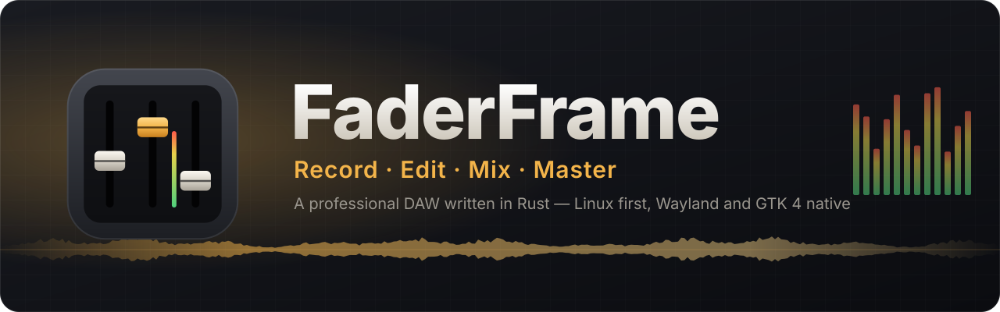
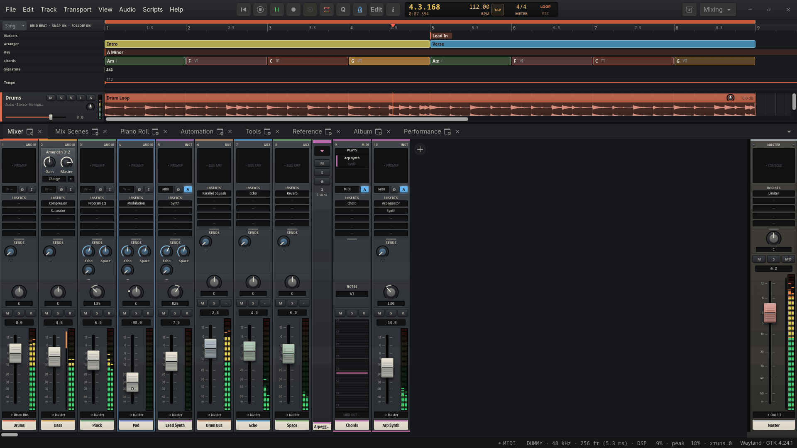
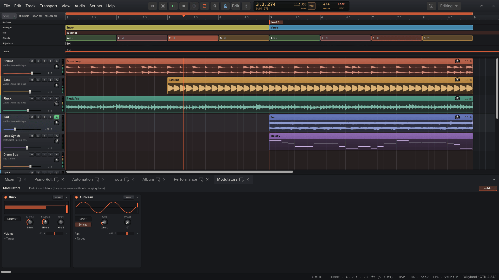
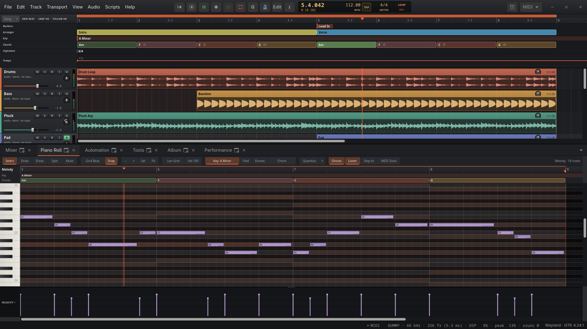
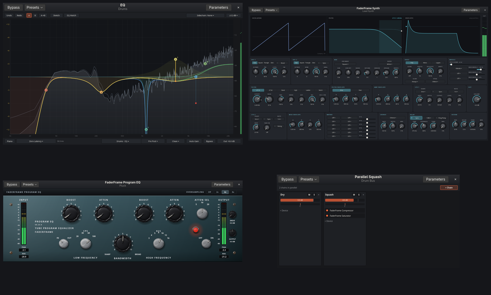
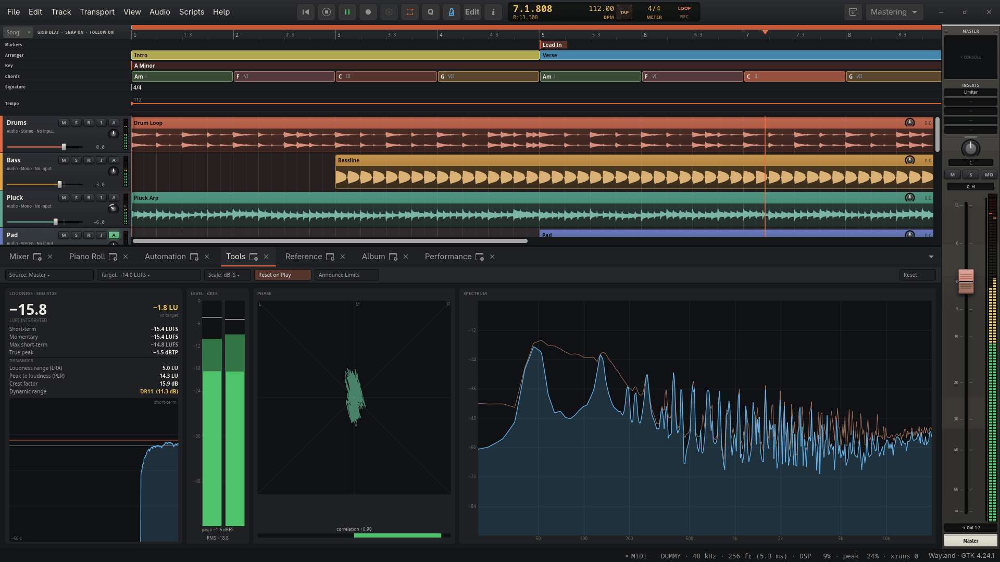
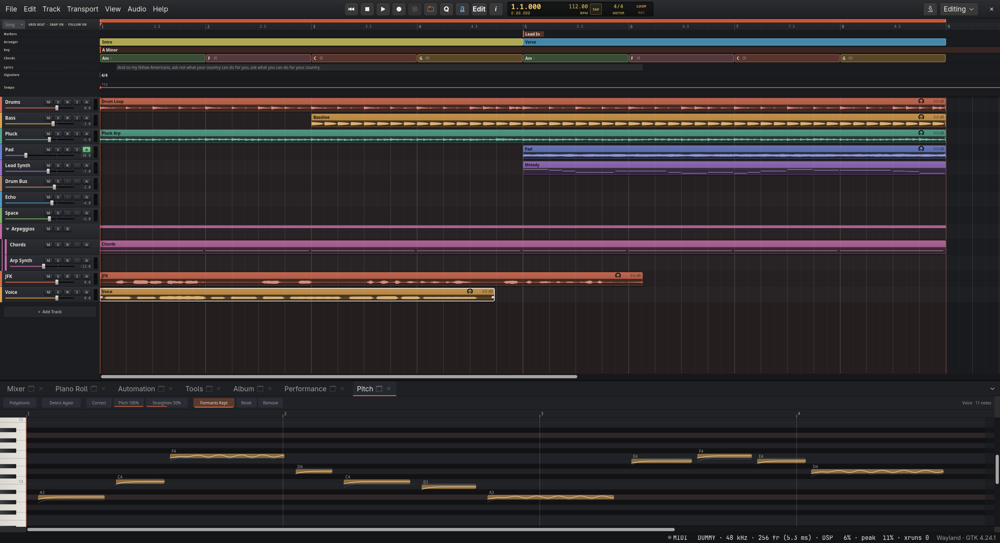
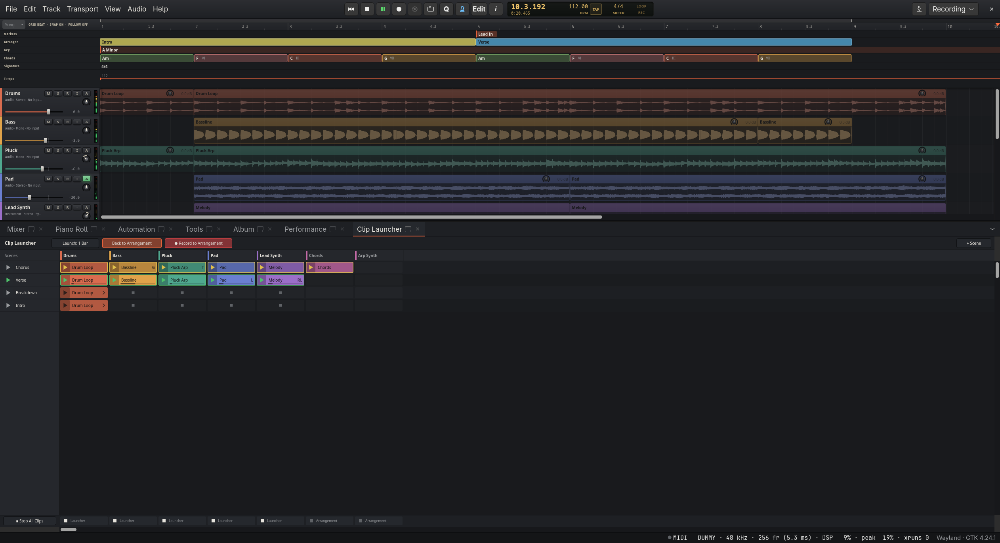
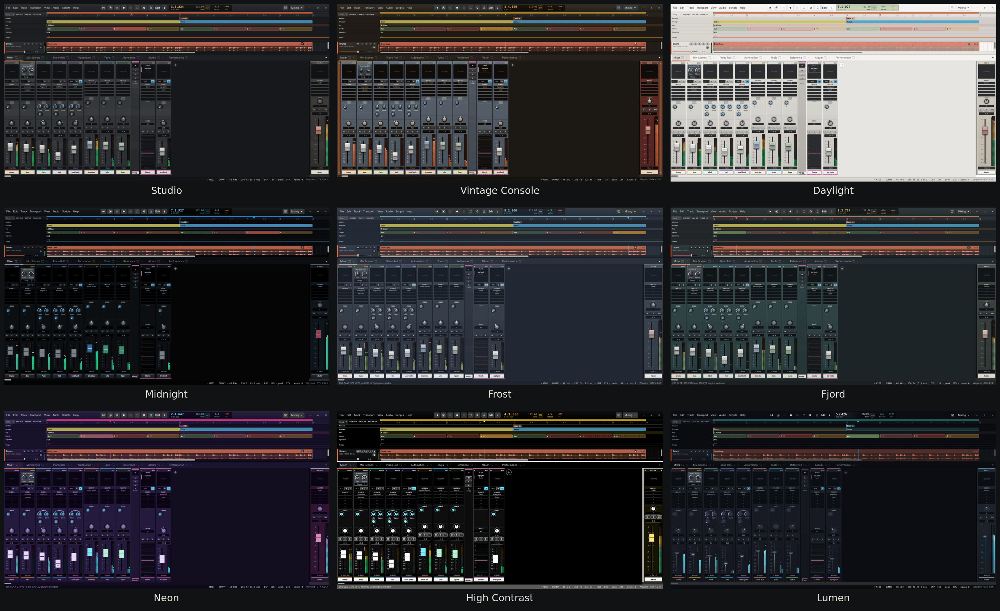

<p align="center">
  
</p>

<p align="center">
  <a href="https://github.com/BurningTreeC/faderframe/releases/latest"></a>
  <a href="https://github.com/BurningTreeC/faderframe/actions/workflows/ci.yml"></a>
  <a href="LICENSE"></a>
  
  
  <a href="https://github.com/BurningTreeC/faderframe/stargazers"></a>
</p>

<p align="center">
  <a href="#download"><b>Download</b></a> ·
  <a href="docs/FEATURES.md"><b>Features</b></a> ·
  <a href="docs/SCREENSHOTS.md"><b>Screenshots</b></a> ·
  <a href="CHANGELOG.md"><b>Changelog</b></a> ·
  <a href="docs/BUILDING.md"><b>Build</b></a> ·
  <a href="docs/TROUBLESHOOTING.md"><b>Help</b></a>
</p>

**FaderFrame** is a multitrack recording, editing, mixing and mastering
environment written in Rust: Linux first, Wayland and GTK 4 native, with
Windows and macOS builds from the same code. It aims to be a professional
DAW, from the first take to the CD, vinyl or immersive master.

<p align="center">
  
</p>

> [!NOTE]
> **In active development** (version 0.47.0). Most of a working DAW is
> there; [docs/ARCHITECTURE.md](docs/ARCHITECTURE.md#status-and-roadmap)
> says what comes next, and the [changelog](CHANGELOG.md) what each
> release brought.

## Contents

- [Highlights](#highlights)
- [Screenshots](#screenshots)
- [Download](#download)
- [Build from source](#build-from-source)
- [Documentation](#documentation)
- [Development](#development)
- [License](#license)

## Highlights

<table>
<tr>
<td width="33%" valign="top">

### 🎚️ Mixing like a console
An analogue-console mixer with modelled preamps and console summing,
buses, aux sends, folder buses, sidechains, groups and VCAs, cue mixes
with talkback for the performers' headphones, and automation of every
parameter.

</td>
<td width="33%" valign="top">

### ⚡ Hard-realtime engine
Graph-based routing, multicore processing, automatic plugin delay
compensation and render-ahead. Plugins run in sandboxes of their own, so
a crashing plugin never takes the session down.

</td>
<td width="33%" valign="top">

### 🔌 Your plugins
CLAP and VST3 everywhere, LV2 on Linux, Audio Units on macOS: CLAP
modulation, MPE and note expressions, plugin GUIs at the desktop's
scale, multi-output instruments on tracks of their own.

</td>
</tr>
<tr>
<td valign="top">

### 🎹 MIDI and instruments
A piano roll with chords, scales and MIDI tools, the key and chord
tracks, MIDI effects, MIDI 2.0 on Linux, a synth, samplers and a drum sampler,
audio to MIDI, and singing into MIDI live.

</td>
<td valign="top">

### 🎛️ Circuit-modelled devices
An optical leveller, a FET compressor, a tape machine, a program EQ, a
guitar rig of amps and pedals, a 24-band EQ, reverbs, delays and
modulation effects, all built in.

</td>
<td valign="top">

### 🧠 Mix Intelligence
Masking, phase, width, dynamics, levels and a health check across the
whole mix, measured and explained, with experiments to audition and
A/B listening against references or earlier steps of the undo history.

</td>
</tr>
<tr>
<td valign="top">

### ✂️ Editing that keeps up
Takes and comping, elastic audio, pitch and polyphonic pitch editing,
spectral editing, restoration and stem separation, clip envelopes and
effects, song sections and an undo history you can listen back to.

</td>
<td valign="top">

### 🔊 Surround and immersive
Surround beds from LCR to 7.1.4 or a speaker layout of your own,
object-based ADM BWF and IAMF masters, and binaural monitoring on
headphones.

</td>
<td valign="top">

### 💿 Mastering and delivery
Loudness, true-peak, phase and spectrum meters, an album view, delivery
presets for streaming and broadcast, CD (DDP) and vinyl masters, and a
render report measured from every file written.

</td>
</tr>
<tr>
<td valign="top">

### 🎬 Picture and stage
Video for working to picture with time-locked tracks, a clip launcher
with scenes and follow actions, setlists with a show mode, and lead
sheets.

</td>
<td valign="top">

### 📱 Control from anywhere
Mackie Control and other surfaces, MIDI learn, MIDI clock sync, and a
phone and web remote: the transport, the mixer, cue mixes, the setlist
and the lyrics in a browser, nothing to install.

</td>
<td valign="top">

### 🎨 Made to be lived in
Dockable, detachable editors, workspaces, nine skins and themes of your
own, a command palette, screen-reader support, project templates and
versions.

</td>
</tr>
</table>

Everything, area by area: **[docs/FEATURES.md](docs/FEATURES.md)**.

## Screenshots

<table>
<tr>
<td width="50%"><a href="docs/SCREENSHOTS.md#arranging-editing-and-recording"></a><br><sub><b>Arranging:</b> global lanes, the key and chord tracks, folders and modulators</sub></td>
<td width="50%"><a href="docs/SCREENSHOTS.md#arranging-editing-and-recording"></a><br><sub><b>Piano roll</b> under the key and chord tracks</sub></td>
</tr>
<tr>
<td><a href="docs/SCREENSHOTS.md#devices"></a><br><sub><b>Devices:</b> EQ, synth, program EQ and a parallel container</sub></td>
<td><a href="docs/SCREENSHOTS.md#mastering-and-delivery"></a><br><sub><b>Mastering:</b> loudness, level, phase and spectrum</sub></td>
</tr>
<tr>
<td><a href="docs/SCREENSHOTS.md#arranging-editing-and-recording"></a><br><sub><b>Vocals:</b> the pitch editor and the lyrics lane</sub></td>
<td><a href="docs/SCREENSHOTS.md#picture-and-performance"></a><br><sub><b>Clip launcher:</b> scenes, launch modes and follow actions</sub></td>
</tr>
</table>

<p align="center">
  <a href="docs/SCREENSHOTS.md#skins"></a><br>
  <sub>Nine skins, switched live, and themes of your own.</sub>
</p>

The full tour, with what each picture shows: **[docs/SCREENSHOTS.md](docs/SCREENSHOTS.md)**.

## Download

Ready-made packages of every release are on the
**[releases page](https://github.com/BurningTreeC/faderframe/releases/latest)**:

| Platform | Package |
|---|---|
| 🐧 Linux x86-64 | portable tarball (runs in place; `install.sh` installs it) or Flatpak |
| 🍎 macOS (Apple Silicon or Intel) | `FaderFrame.app` in a DMG |
| 🪟 Windows x64 | installer or portable zip |

The packages carry GTK and GStreamer with them. The macOS app and the
Windows builds are not signed: [docs/BUILDING.md](docs/BUILDING.md#packages)
says how to open them the first time, and how portable mode keeps
everything next to the program.

## Build from source

You need Rust 1.92 or newer, GTK 4.14+ and GStreamer; the packages for
each distribution, macOS and Windows are listed in
[docs/BUILDING.md](docs/BUILDING.md).

```bash
cargo build --release
cargo run --release -p faderframe-app -- --demo   # starts with the demo session
```

## Documentation

| | |
|---|---|
| [Features](docs/FEATURES.md) | everything FaderFrame does, by area |
| [Screenshots](docs/SCREENSHOTS.md) | a tour, workspace by workspace |
| [Keyboard shortcuts](docs/SHORTCUTS.md) | the default keys |
| [Building and packaging](docs/BUILDING.md) | requirements, the command line, the packages, portable mode |
| [Troubleshooting](docs/TROUBLESHOOTING.md) | crash reports, freezes, logs, realtime rights, the remote |
| [Scripting](docs/SCRIPTING.md) | Lua 5.4 scripts and macros |
| [Architecture](docs/ARCHITECTURE.md) | the design, the crates, the invariants and the roadmap |
| [Changelog](CHANGELOG.md) | what each release changed |

## Development

```bash
cargo fmt --all -- --check
cargo clippy --workspace --all-targets
cargo test --workspace                 # or: cargo nextest run --workspace
cargo run -p faderframe-bench --release -- --tracks 128 --block 64 --rate 96000
python3 scripts/third_party_licenses.py --check
cargo deny check licenses bans sources
```

The workspace has 68 crates and over 2,100 tests; about 60 of them are
opt-in (`--ignored`): they need something from outside (an installed
plugin, a model, real MIDI or audio hardware) or measure speed. See
[docs/ARCHITECTURE.md](docs/ARCHITECTURE.md) for the design, crate
responsibilities and invariants.

The [changelog](CHANGELOG.md) is generated from the commit history: after
tagging a release, run `python3 scripts/changelog.py`. The release
workflow puts the same notes on the GitHub release.
`scripts/screenshots.sh` retakes the README's screenshots of the demo
session (the workspaces and the skins), with settings of its own.

## License

FaderFrame is released under the [MIT license](LICENSE). Third-party
components and their licenses are listed in
[THIRD_PARTY_LICENSES.md](THIRD_PARTY_LICENSES.md).
