# Screenshots

A tour of FaderFrame, workspace by workspace.

They show the demo session (`--demo`, or Preferences → General → On
start-up): eight bars in A minor whose audio is generated, so it needs no
files (the vocals, picture and drum-sampler shots add imported files). The
main set is in the default Studio skin.

## Arranging, editing and recording

The Editing workspace: markers, the Intro and Verse sections, the key and
the chord track above the tracks, and in the bottom dock the pad's
modulators — an envelope follower that ducks it under
the drums and a synced LFO that moves it across the stereo field. Beside
the transport are the Q (input quantize) and the "i" (Inspector) buttons:

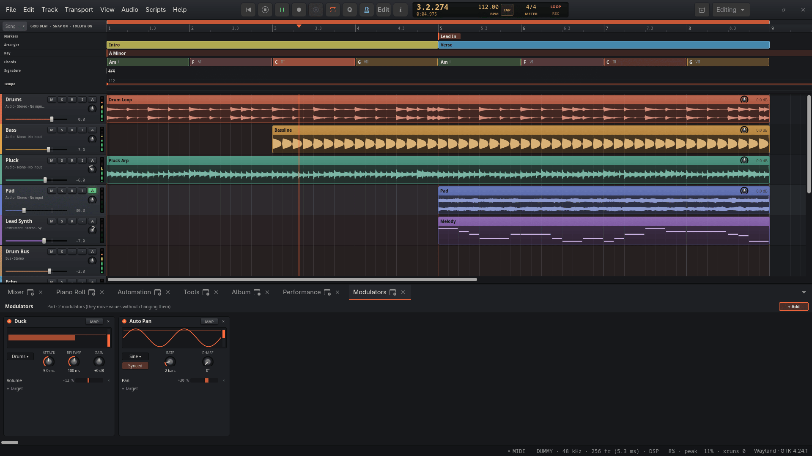

Snap to Objects: the Bassline dragged in Slip mode (where nothing else
attracts it) lands on the start of the Pad and Melody clips at bar 5; the
guide line names what it caught. Above it the edit toolbar, with Objects
and Samples (snap to samples) on:

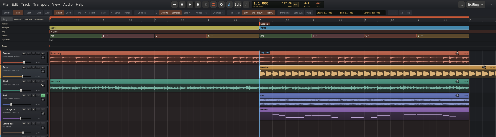

A scratch pad: the Verse copied into a pad of its own ("Verse Idea" —
its clips, section, key and chords) to try something without touching the
song. The switcher in the arranger's corner shows the pad in the accent
colour, the ruler is tinted, and its menu goes back to the song, makes
new pads or brings this one into the song:

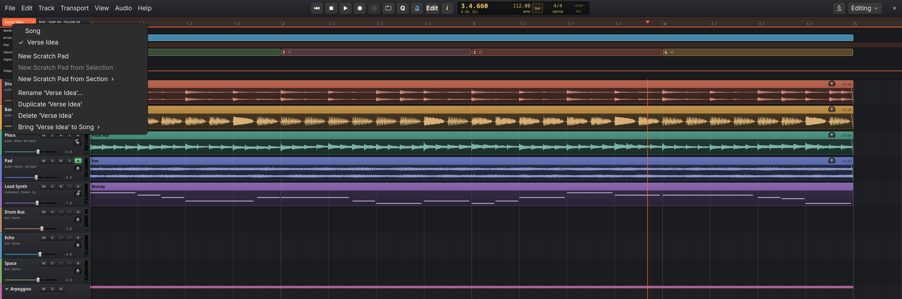

Recording from bar 1 with a two-bar pre-roll: what lies before the
project's start is counted in — the counter runs up from −1.1 with
COUNT-IN under it and the ruler shows a badge — and playback and the take
begin on bar 1. The Transport menu holds the stop behaviours, aborting a
take, the Play Start Marker and check marks for every switch:

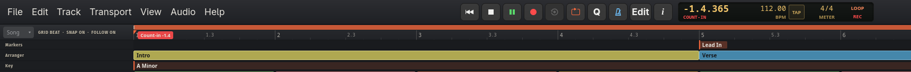

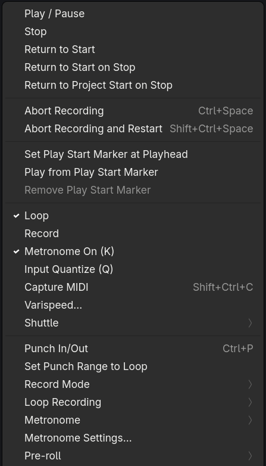

The MIDI workspace with the piano roll editing the lead synth's melody,
the key and the chords above the notes and the scale highlighted:

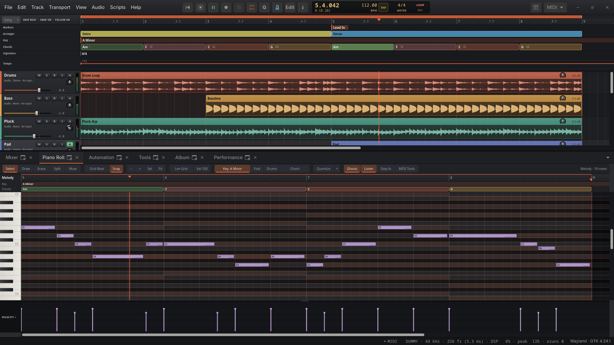

Clips: the plucks' harmony and the drum loop's hits converted to MIDI on
new tracks under them, and the pad's clip effects (a compressor, a
saturator and a reverb rendered into the audio it plays):

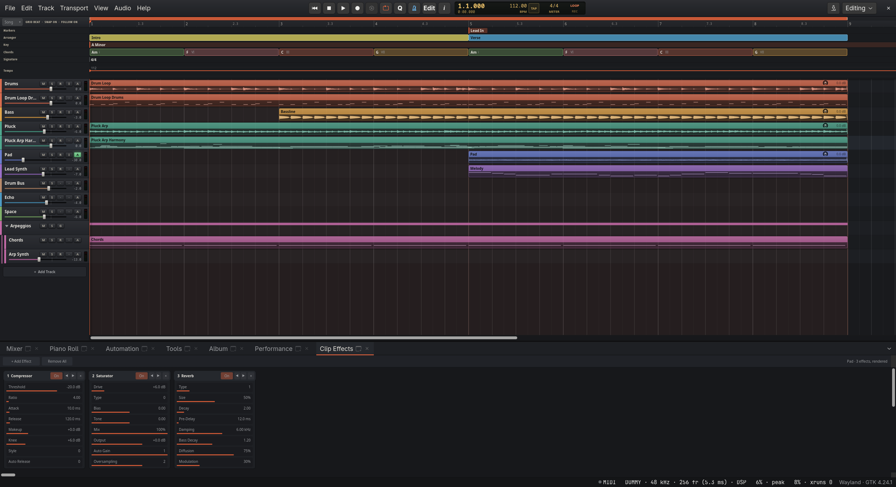

Vocals: a sung phrase in the pitch editor, its notes corrected to the key
(their sung positions faintly behind them, the vibrato halved), and a
speech clip transcribed into the Lyrics lane above the tracks (both
imported into the demo):

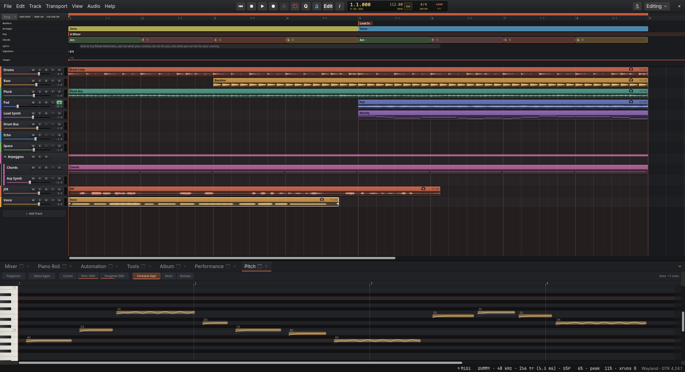

## Mixing

The Mixing workspace: a preamp on the bass, inserts, sends to an echo and
a reverb aux, a MIDI track's strip (it plays the arpeggiating synth), the
drum bus's parallel-compression container and a true-peak limiter on the
master:

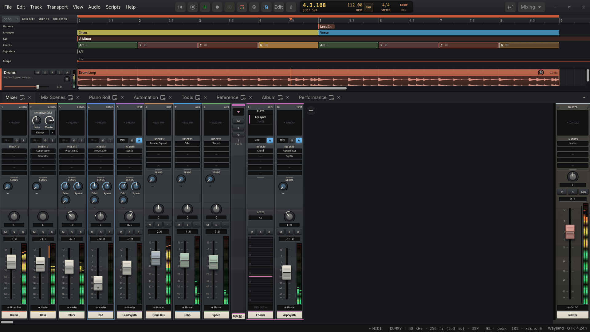

The Inspector (F11, or the "i" in the header bar) on the left with the
selected bass track — its routing, track settings, devices (with their
latency and gain reduction) and its channel strip — and the Channel
Overview in the bottom dock: input → American 312 preamp → Compressor →
Saturator → channel → sends → output:

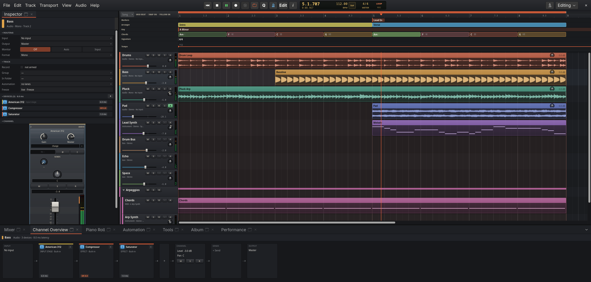

Folders that are buses and groups: the Arpeggios folder sums its tracks
(BUS in its header, its strip a FOLDER BUS in the Inspector) and its G
switch makes them one for editing and arming:

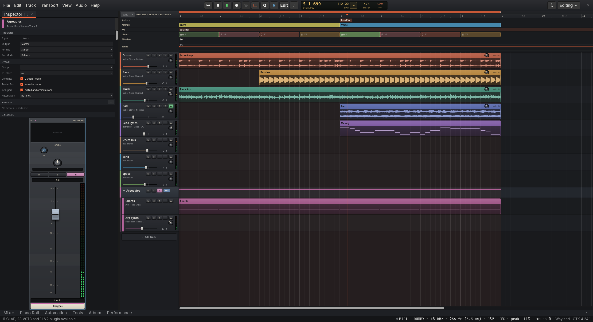

A cue mix for the performers' headphones: the bar over the strips switches
the mixer between the main mix and Cue 1 (Copy Main Mix, pre-fader taps,
TALK latched); every fader, pan and mute now sets the track's send to the
cue mix, framed in its colour — a track that reaches the master through a
bus is off by the console rule (the drums go through the drum bus) — and
the master section is the cue mix's own, on outputs 3–4 with its click:

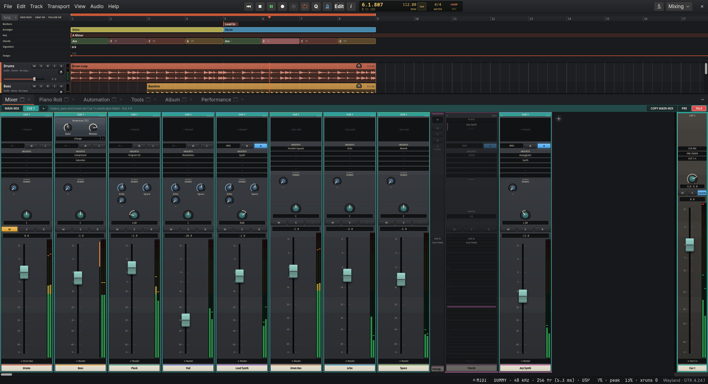

A multi-output instrument: the Drum Sampler on the lead synth's track
plays its pads (loaded with six samples, its editor on the right) into
its outputs, and Create Output Tracks gave every output a track of its
own in one step — Lead Synth Main and Out 1–8, in a folder under the
instrument, routed where it went (its own track now only carries the
instrument):

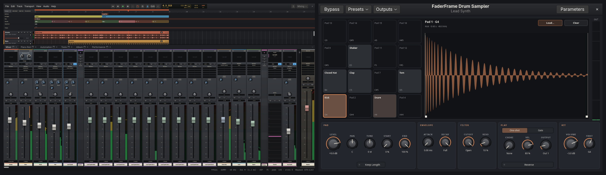

Surround and objects: the master as a 7.1.4 bed, the tracks placed in its
room (the small rooms in the mixer strips, their meters showing every
channel), the lead synth as an object, and the Surround Panner with the
pad behind the listener and up high:

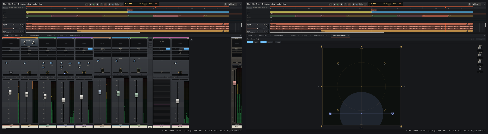

## Devices

Device editors: the EQ (dynamic and spectral bands, analyser), the Synth
(three decks of sections under its oscillator, filter and envelope
displays — LFO 2, the mod envelope, the modulation matrix, the wheels,
chorus, delay and reverb among them), the Program EQ and the Parallel
Squash container on the drum bus:

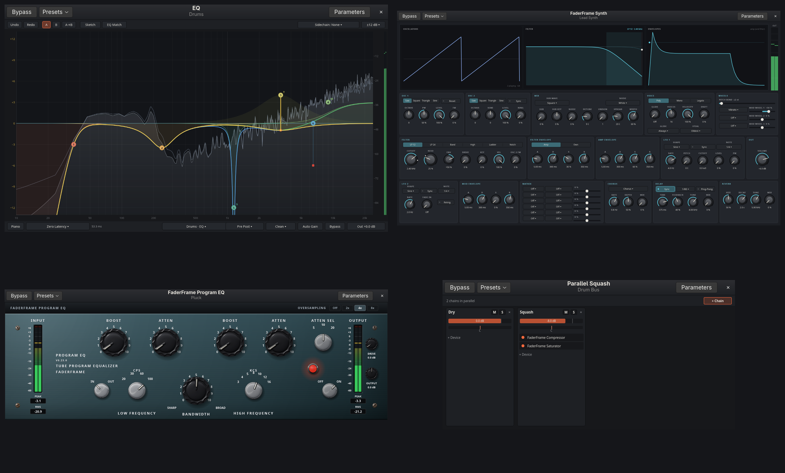

The Compressor on the bass (its transfer curve and the gain reduction over
the signal), the true-peak Limiter on the master with its loudness
readouts, the Reverb and the Delay (Echo):

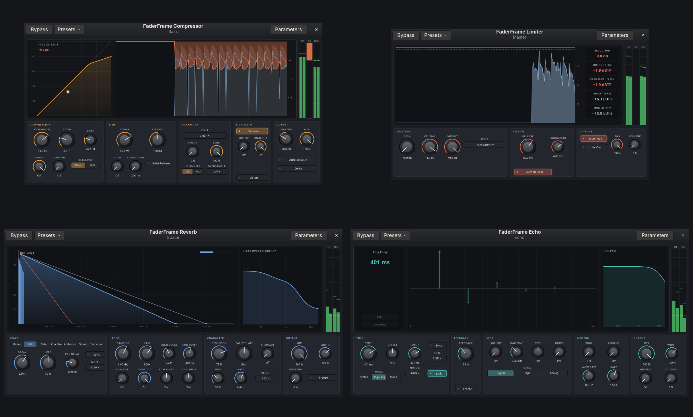

## Mastering and delivery

The Mastering workspace with the Tools view (EBU R128 loudness, levels,
phase and spectrum):

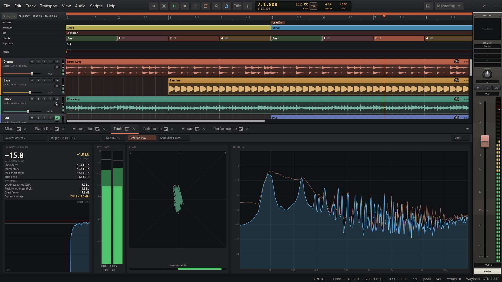

The album: the demo's sections as songs, analysed, with what delivery will
make of them (levelling, limiting) and the CD and vinyl masters a click
away:

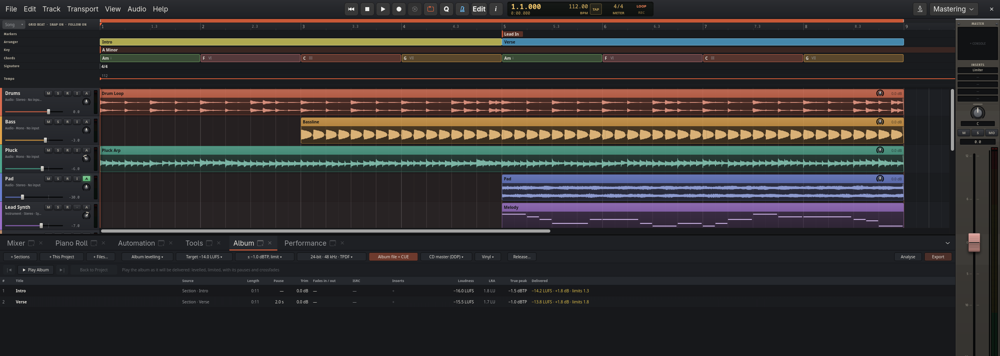

After every render and album export, a report measured from the files as
written:

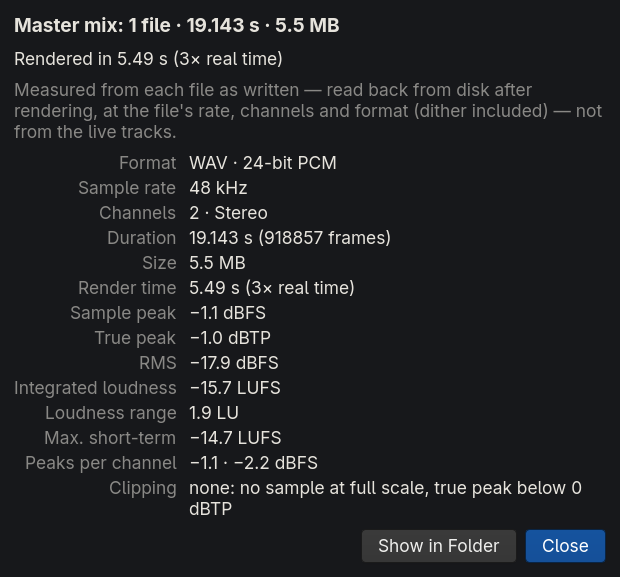

## Picture and performance

Picture: a movie in the arranger's Video lane above the demo (a filmstrip
of the clip) and the video window in the bottom dock, frame-exact against
the sound — the time burnt into the picture (10.440 s) and the overlay's
project timecode (00:00:10:11 at 25 frames a second) agree:

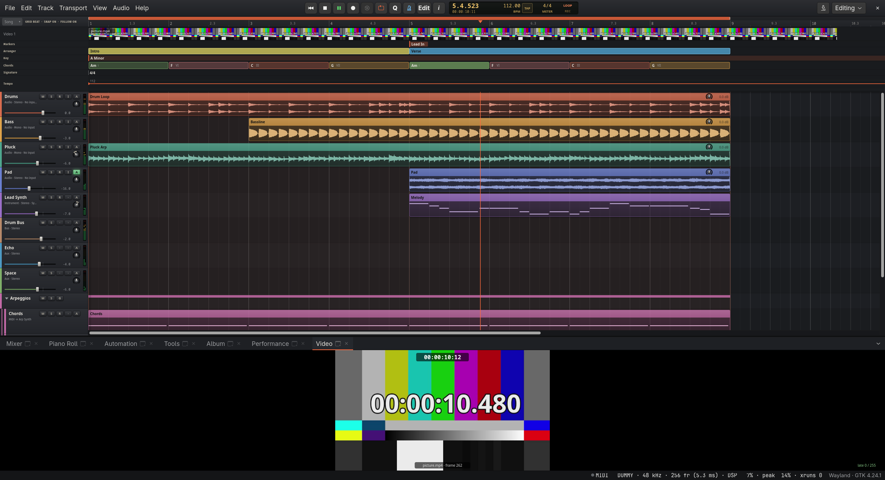

The clip launcher: the demo's clips sent to it in four scenes, the Verse
playing (green, each clip's loop progress under its name) and the Chorus
waiting for the next bar (yellow). The letters are launch modes (G gate,
T toggle, R repeat, L legato), the chevrons follow actions. Record to
Arrangement is on: every loop played to its end is already written into
the arrangement above, where the tracks that play the launcher are
dimmed:

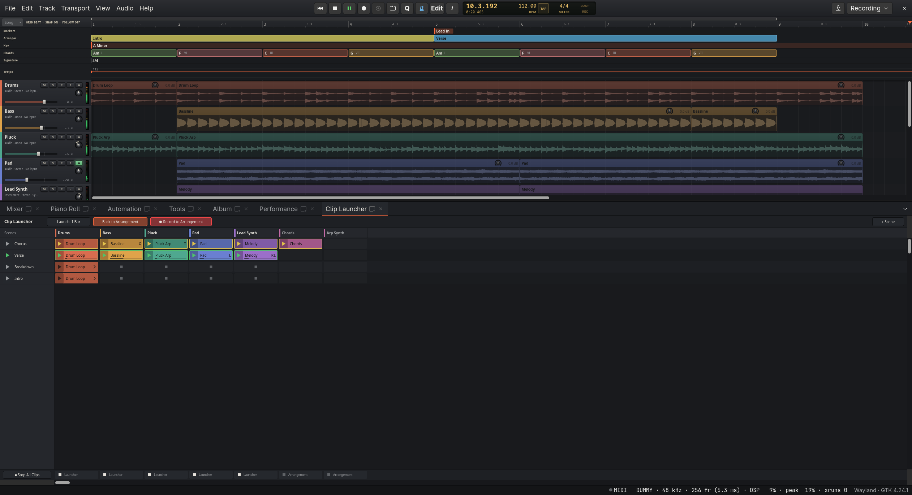

## Setting up

Preferences → Audio (here on the silent dummy device with a pretend
eight-channel interface): the devices, sample rate, buffer size and
channels, then what runs — the stream, the latencies (recordings move back
by the input and output latency) and where each channel goes. With
PipeWire or JACK it also offers a second device to play on or record from:

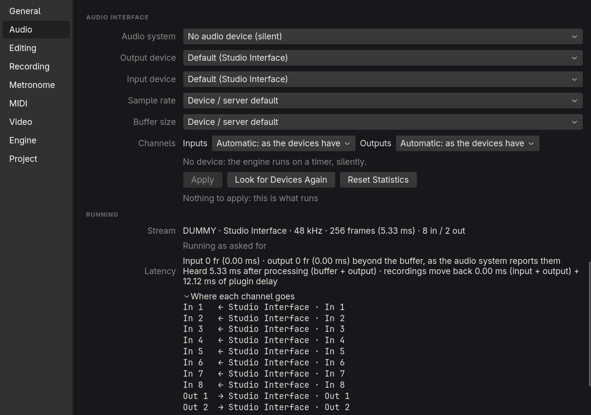

The plugin browser with favorites in categories of your own, a plugin's
details and its realtime check:

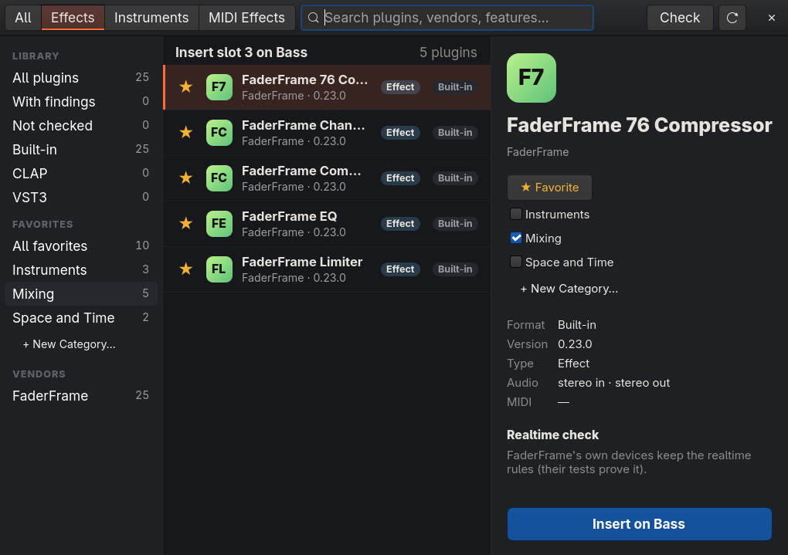

## Skins

Nine skins, switched live (View → Theme or Preferences → General → Theme):
Studio, Vintage Console (walnut cheeks, enamel panels, skirted knobs,
plasma bar-graph meters), Daylight (light), Midnight, Frost, Fjord (dark
slate and petrol panels with coral and old-gold light, calm contrast for
long sessions), Neon, High Contrast and Lumen:

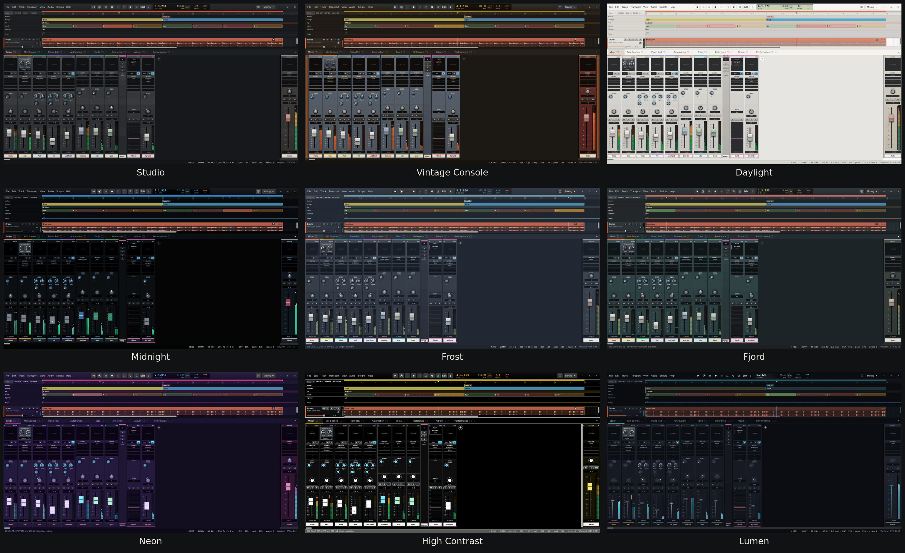

Themes of your own: View → Theme → Edit Themes… starts from a built-in
skin and changes any of its 56 colours, applied as you edit; they are JSON
files in the settings' `themes` folder and appear after the built-in
skins.

Lumen, the newest skin, is drawn with light instead of hardware: ink planes
stepped by luminance, halo knobs with glowing value arcs, pill faders and
buttons that light from within, fine gradient meters with a bloom, clips
as translucent cards, a glass transport display in tabular figures and one
cyan-to-violet accent:

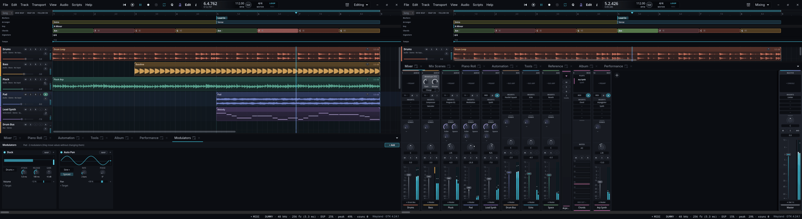
